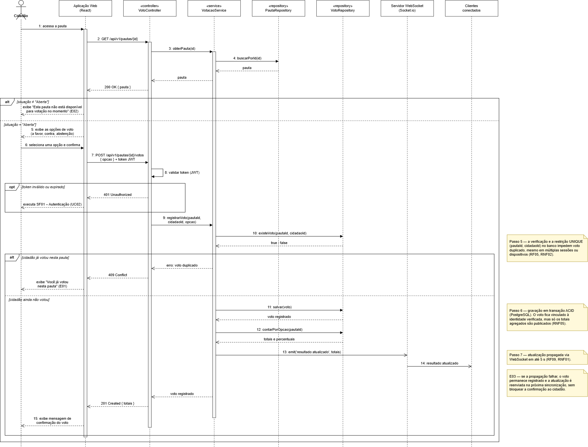

# PautaViva — Documento de Especificação de Software

**Universidade São Judas Tadeu**  
Curso de Bacharelado em Engenharia de Computação

Documento de especificação de software apresentado ao curso de Bacharelado em Engenharia de Computação da Universidade São Judas Tadeu, reunindo o levantamento de requisitos, a modelagem, o planejamento ágil e a arquitetura de software do PautaViva, plataforma digital de participação comunitária.

**Orientador:** Prof. Nelson Aguiar  
São Paulo, 2026

**Equipe de Desenvolvimento**

- Gabriel Xavier Antunes
- Guilherme Amaral da Silva
- Guilherme Previati Oliveira
- João Pedro de Carvalho Gomes
- João Victor dos Santos Silva
- Matheus Saporito Nastari

---

## Resumo

A participação da comunidade em decisões sobre questões locais costuma ocorrer por meio de canais dispersos, como redes sociais, grupos de mensagens e reuniões presenciais, o que dificulta a organização das propostas, o registro das discussões e a apuração confiável dos resultados. Para enfrentar esse problema, este documento especifica o PautaViva, uma plataforma digital de participação comunitária, em desenvolvimento, voltada à proposição, discussão, moderação e votação de pautas locais, com resultados de caráter consultivo. A plataforma permite que cidadãos com conta verificada por e-mail e CPF válido consultem e discutam pautas e votem uma única vez em cada uma, com o registro de quem votou mantido separado do conteúdo do voto, de forma a preservar o sigilo. Os comentários passam por uma triagem automática, realizada por um modelo de linguagem, que bloqueia conteúdos claramente impróprios antes de seguirem para a moderação humana. Os resultados das votações são atualizados em tempo real por meio de WebSocket e, ao término de cada votação, ficam disponíveis em gráficos e para exportação. O desenvolvimento é conduzido sob a metodologia ágil Scrum, e o documento reúne o levantamento de requisitos funcionais e não funcionais, a modelagem do sistema por meio de diagramas UML, a arquitetura de software e o plano de avaliação, que contempla testes de carga, de concorrência e da eficácia da moderação automática. Espera-se que o PautaViva amplie a participação cidadã em processos de decisão local, reduzindo as barreiras de tempo e mobilidade dos modelos tradicionais de participação.

**Palavras-chave:** Participação Cidadã. Consulta Pública Digital. Votação em Tempo Real. WebSocket. Moderação de Conteúdo.

## Abstract

Community participation in local decision-making often occurs through dispersed channels, such as social networks, messaging groups and in-person meetings, which hinders the organization of proposals, the recording of discussions and the reliable tallying of results. To address this problem, this document specifies PautaViva, a digital community participation platform under development for proposing, discussing, moderating and voting on local agendas, whose results are consultative. The platform allows citizens with an email-verified account and a valid taxpayer ID (CPF) to browse and discuss agendas and to vote only once on each of them, keeping the record of who voted separate from the content of the vote in order to preserve ballot secrecy. Comments go through an automated screening, performed by a large language model, which blocks clearly inappropriate content before it reaches human moderation. Voting results are updated in real time via WebSocket and, at the end of each vote, are presented in charts and made available for export. Development follows the Scrum agile methodology, and the document gathers the functional and non-functional requirements, the UML models, the software architecture and the evaluation plan, which covers load, concurrency and automated-moderation effectiveness tests. PautaViva is expected to broaden citizen participation in local decision-making by reducing the time and mobility barriers of traditional participation models.

**Keywords:** Civic Participation. Digital Public Consultation. Real-Time Voting. WebSocket. Content Moderation.

## Lista de figuras

- Figura 1 – Diagrama de casos de uso do PautaViva
- Figura 2 – Diagrama de classes do PautaViva
- Figura 3 – Diagrama de sequência do fluxo de votação em pauta
- Figura 4 – Arquitetura em camadas do PautaViva

## Lista de quadros

- Quadro 1 – Descrição resumida dos atores
- Quadro 2 – Requisitos funcionais
- Quadro 3 – Requisitos não funcionais
- Quadro 4 – Modelo de ameaça: acesso às informações de voto
- Quadro 5 – Product backlog
- Quadro 6 – Critérios de aceite da HU05 (Votar em pauta)
- Quadro 7 – Cronograma de sprints
- Quadro 8 – Planejado x realizado
- Quadro 9 – Plano de avaliação do sistema
- Quadro 10 – Tecnologias por camada

## Lista de abreviaturas e siglas

| Sigla | Significado |
| --- | --- |
| API | Application Programming Interface (interface de programação de aplicações) |
| CPF | Cadastro de Pessoas Físicas |
| CSV | Comma-Separated Values (valores separados por vírgula) |
| HU | História de usuário |
| IA | Inteligência artificial |
| LGPD | Lei Geral de Proteção de Dados Pessoais |
| LLM | Large Language Model (modelo de linguagem de grande escala) |
| MVC | Model-View-Controller |
| MVP | Minimum Viable Product (produto mínimo viável) |
| ORM | Object-Relational Mapping (mapeamento objeto-relacional) |
| PDF | Portable Document Format |
| REST | Representational State Transfer |
| RF | Requisito funcional |
| RNF | Requisito não funcional |
| SMTP | Simple Mail Transfer Protocol |
| SPA | Single-Page Application (aplicação de página única) |
| SUS | System Usability Scale (escala de usabilidade de sistemas) |
| UC | Caso de uso (use case) |
| UML | Unified Modeling Language |
| WCAG | Web Content Accessibility Guidelines |

---

## Sumário

1. [Introdução](#1-introdução)
2. [Requisitos do sistema](#2-requisitos-do-sistema)
3. [Metodologia ágil e gestão do projeto](#3-metodologia-ágil-e-gestão-do-projeto)
4. [Modelagem do sistema](#4-modelagem-do-sistema)
5. [Arquitetura do sistema](#5-arquitetura-do-sistema)
6. [Considerações finais](#6-considerações-finais)
7. [Referências](#referências)

---

## 1 Introdução

### 1.1 Contextualização

A participação da comunidade em decisões sobre questões locais é importante para que diferentes pessoas possam apresentar suas opiniões e discutir problemas que afetam o seu dia a dia. Porém, na maioria das vezes, as discussões acontecem por diferentes meios, como redes sociais, grupos de mensagens ou reuniões presenciais, dificultando a organização das propostas, das discussões e das votações.

No Brasil, a Lei do Governo Digital (BRASIL, 2021) incluiu o estímulo à participação social entre os princípios da prestação digital de serviços públicos, e iniciativas como a plataforma Brasil Participativo mostram o potencial desse canal: lançada em 2023 pelo governo federal, a plataforma reuniu mais de 1,4 milhão de participantes na etapa digital de elaboração do Plano Plurianual 2024–2027 (BRASIL, 2023). Experiências internacionais, como as plataformas Decidim, em Barcelona, e Consul, em Madri, também indicam que ambientes digitais estruturados favorecem a deliberação e o registro das contribuições dos cidadãos (ARAGÓN et al., 2017).

Pensando nisso, este documento descreve a especificação do PautaViva, uma plataforma digital que centraliza a criação, a discussão e a votação de pautas relacionadas à comunidade. O sistema permite que os usuários consultem pautas, participem das discussões e registrem seus votos, conta com uma triagem automática dos comentários antes da moderação humana e utiliza WebSocket para atualizar os resultados das votações em tempo real, que são apresentados em gráficos e podem ser exportados.

As votações realizadas no PautaViva têm caráter consultivo: os resultados expressam a opinião dos participantes sobre cada pauta e servem de subsídio à gestão pública, mas não possuem valor oficial nem vinculam a decisão dos gestores.

### 1.2 Justificativa

O desenvolvimento da plataforma se justifica pela possibilidade de unificar, em um único ambiente organizado e seguro, as diferentes etapas do processo de participação comunitária, desde a criação da pauta até a sua discussão e votação. As plataformas de participação existentes, como Decidim e Consul, foram concebidas para administrações públicas de grande porte e exigem implantação e configuração complexas; o PautaViva propõe uma solução mais enxuta, voltada a comunidades locais, com foco na apuração confiável dos votos, no sigilo do voto individual e no acompanhamento dos resultados em tempo real.

Do ponto de vista acadêmico, o desenvolvimento deste projeto também permite aplicar na prática conhecimentos adquiridos ao longo do curso, como modelagem orientada a objetos, arquitetura de software, desenvolvimento web, banco de dados, comunicação em tempo real e gestão ágil de projetos, reunindo-os no desenvolvimento de uma aplicação completa, desde o planejamento e a definição dos requisitos até a implementação e a avaliação do sistema.

### 1.3 Trabalhos relacionados

O Decidim é uma plataforma de código aberto criada pela Prefeitura de Barcelona para apoiar processos participativos, como planos estratégicos e orçamentos participativos, combinando propostas, debates e votações. Aragón et al. (2017) analisaram as discussões on-line do Decidim Barcelona, em um processo com mais de 40 mil cidadãos, e observaram que o desenho da interface de comentários influencia o engajamento na deliberação. No Brasil, o Decidim é a base da plataforma Brasil Participativo, do governo federal (BRASIL, 2023).

O Consul Democracy, originado em 2015 como a plataforma Decide Madrid, da Prefeitura de Madri, é outro software livre de participação cidadã, que oferece propostas, debates, orçamentos participativos e consultas e foi adotado por centenas de cidades e organizações (CONSUL DEMOCRACY FOUNDATION, 2026).

Em relação a esses trabalhos, o PautaViva concentra-se em um escopo menor — a consulta comunitária sobre pautas locais — e se diferencia pela atualização dos resultados em tempo real, pela separação entre o registro de participação e o conteúdo do voto e pela triagem automática de comentários por um modelo de linguagem, combinada à moderação humana.

### 1.4 Objetivos

#### 1.4.1 Objetivo geral

Desenvolver o PautaViva, uma plataforma digital de participação comunitária, de caráter consultivo, que permite aos usuários criar, discutir e votar em pautas relacionadas à sua comunidade, com atualização dos resultados em tempo real e a possibilidade de visualização e exportação dos resultados.

#### 1.4.2 Objetivos específicos

- Definir os requisitos funcionais e não funcionais necessários para o funcionamento do sistema;
- Representar, por meio de diagrama de casos de uso, as interações entre os atores e o sistema;
- Desenvolver o cadastro e a autenticação dos usuários, com validação e unicidade do CPF e confirmação de e-mail;
- Permitir a criação, visualização e discussão de pautas, com moderação automática dos comentários publicados;
- Desenvolver e implementar o sistema de votação das pautas, com atualização dos resultados em tempo real por meio de WebSocket;
- Organizar o desenvolvimento em um product backlog de histórias de usuário, priorizado e distribuído em sprints com datas de entrega definidas;
- Modelar a estrutura estática do sistema por meio de diagrama de classes;
- Modelar o comportamento dinâmico de um dos principais fluxos do sistema por meio de diagrama de sequência;
- Definir a arquitetura de software do sistema e as tecnologias associadas a cada camada;
- Apresentar os resultados das votações por meio de gráficos e permitir sua exportação em CSV e PDF;
- Avaliar o sistema quanto à carga suportada, ao atraso de propagação dos resultados, à integridade do voto e à eficácia da moderação automática, conforme o plano de avaliação (Seção 3.3).

---

## 2 Requisitos do sistema

Este capítulo apresenta o levantamento de requisitos do PautaViva, iniciando pela identificação dos atores e casos de uso do sistema (Seção 2.1), seguida da listagem dos requisitos funcionais (Seção 2.2), do detalhamento do fluxo principal, dos fluxos alternativos e das exceções de cada caso de uso (Seção 2.3), dos requisitos não funcionais (Seção 2.4) e, por fim, do modelo de ameaça e das limitações do sistema (Seção 2.5).

### 2.1 Diagrama de casos de uso

A Figura 1 apresenta o diagrama de casos de uso do sistema, elaborado segundo a notação UML (Unified Modeling Language). Foram identificados cinco atores primários — Cidadão, Gestor Público, Moderador, Administrador e Temporizador do Sistema, este responsável por disparar o encerramento automático das votações na data/hora definida — e um ator secundário: o Sistema de Moderação Automática, serviço externo de inteligência artificial (API Google Gemini) que classifica o conteúdo dos comentários.

> **Figura 1 – Diagrama de casos de uso do PautaViva**
> 
> Fonte: elaborado pelos autores (2026)

O caso de uso UC02 (Realizar login) é incluído (`<<include>>`) pelos casos de uso que exigem autenticação prévia, como votar, comentar, cadastrar pauta e moderar comentários. O caso de uso UC06 (Comentar pauta) é associado ao ator secundário Sistema de Moderação Automática, que realiza a triagem de todos os comentários enviados antes de chegarem à fila de moderação humana; por se tratar de um serviço externo acionado em todo envio, a relação é modelada como associação com o ator, e não como `<<extend>>`. O caso de uso UC12 (Gerenciar perfis de acesso) permite ao Administrador cadastrar gestores públicos e moderadores, já que o UC01 trata apenas do autocadastro do cidadão. Já o encerramento automático da votação (RF10) é representado pelo caso de uso UC11, iniciado pelo ator Temporizador do Sistema, sem intervenção humana.

#### 2.1.1 Descrição resumida dos atores

**Quadro 1 – Descrição resumida dos atores**

| Ator | Descrição |
| --- | --- |
| Cidadão | Usuário cadastrado que consulta pautas, vota, comenta e pode denunciar comentários impróprios. |
| Gestor Público | Responsável pelo cadastro e pela edição de pautas e pela exportação dos resultados finais das votações. |
| Moderador | Responsável por aprovar, rejeitar ou remover comentários da fila de moderação, incluindo os denunciados por cidadãos. |
| Administrador | Responsável por cadastrar gestores públicos e moderadores e por alterar os perfis de acesso dos usuários. |
| Sistema de Moderação Automática (secundário) | Serviço externo de inteligência artificial (API Google Gemini) que classifica o conteúdo dos comentários; a decisão de bloquear ou encaminhar o comentário é tomada pelo PautaViva a partir dessa classificação. |
| Temporizador do Sistema | Dispara o encerramento automático da votação na data/hora definida. |

Fonte: elaborado pelos autores (2026)

### 2.2 Requisitos funcionais

Os requisitos funcionais (RF) descrevem as funcionalidades que o sistema deve disponibilizar aos usuários. A coluna "Prioridade" segue a classificação MoSCoW (Essencial, Importante, Desejável), utilizada para orientar o planejamento das sprints.

**Quadro 2 – Requisitos funcionais**

| ID | Descrição | Prioridade |
| --- | --- | --- |
| RF01 | O sistema deve permitir que o cidadão se autocadastre, informando e-mail e CPF, com confirmação por e-mail antes da liberação do acesso. | Essencial |
| RF02 | O sistema deve permitir que cidadãos, gestores públicos, moderadores e administradores realizem login mediante credenciais, desde que a conta esteja ativa (e-mail confirmado). | Essencial |
| RF03 | O sistema deve permitir que o gestor público cadastre pauta com título, descrição, categoria, data de início e data de término da votação. | Essencial |
| RF04 | O sistema deve permitir que o cidadão consulte e visualize as pautas disponíveis, filtrando por categoria e status (aberta/encerrada). | Essencial |
| RF05 | O sistema deve permitir que o cidadão vote (a favor, contra ou abstenção) em uma pauta uma única vez por conta verificada. | Essencial |
| RF06 | O sistema deve permitir que o cidadão comente uma pauta, enviando o comentário à triagem automática de conteúdo e, em seguida, à fila de moderação antes da publicação. | Importante |
| RF07 | O sistema deve permitir que o moderador aprove, rejeite ou remova comentários da fila de moderação, avaliando também aqueles denunciados pelos cidadãos. | Importante |
| RF08 | O sistema deve permitir que o cidadão denuncie um comentário publicado, enviando-o para reavaliação do moderador. | Desejável |
| RF09 | O sistema deve exibir painel de resultados com o percentual de votos por opção e o total de participantes, atualizado em tempo real por meio de WebSocket. | Essencial |
| RF10 | O sistema deve encerrar automaticamente a votação na data/hora definida, bloqueando novos votos. | Essencial |
| RF11 | O sistema deve permitir a exportação dos resultados finais de uma pauta encerrada, nos formatos CSV e PDF. | Importante |
| RF12 | O sistema deve permitir que o administrador cadastre contas de gestor público e de moderador e altere o perfil de acesso dos usuários. | Essencial |
| RF13 | O sistema deve permitir que o gestor público edite uma pauta com situação "Agendada", antes do início da votação. | Importante |
| RF14 | O sistema deve permitir que o usuário redefina a senha por meio de link temporário enviado ao e-mail cadastrado. | Essencial |

Fonte: elaborado pelos autores (2026)

### 2.3 Detalhamento dos fluxos dos casos de uso

Esta seção detalha, para cada caso de uso apresentado na Figura 1, o fluxo principal (sequência de passos executada na ausência de desvios), os fluxos alternativos (variações válidas do fluxo principal, identificadas pelo código "FA"), os sub-fluxos (trechos reutilizados por mais de um caso de uso por meio da relação `<<include>>`, identificados pelo código "SF") e as exceções (situações de erro que interrompem ou desviam o fluxo, identificadas pelo código "E"). Essa notação segue a prática usual de especificação de casos de uso da Engenharia de Software (ex.: COCKBURN, 2000) e complementa os requisitos funcionais listados na Seção 2.2, detalhando o comportamento esperado do sistema passo a passo.

#### 2.3.1 UC01 – Cadastrar-se

**Ator(es) principal(is):** Cidadão
**Pré-condições:** O cidadão não possui cadastro ativo no sistema.
**Pós-condições:** Conta criada com situação "Pendente de confirmação" até a verificação do e-mail.

**Fluxo principal**

1. O cidadão acessa a tela de cadastro.
2. O sistema solicita nome completo, CPF, e-mail e senha.
3. O cidadão preenche os dados e confirma.
4. O sistema valida o formato do e-mail e o formato e os dígitos verificadores do CPF.
5. O sistema verifica se já existe cadastro ativo com o mesmo CPF ou e-mail.
6. O sistema registra a conta com situação "Pendente de confirmação" e envia e-mail de confirmação com link de verificação.
7. O sistema exibe mensagem informando que o cadastro será concluído após a confirmação do e-mail.

**Fluxos alternativos**

FA01 – Confirmação do e-mail (fluxo complementar, disparado pelo link recebido)

1. O cidadão acessa o link de confirmação recebido por e-mail.
2. O sistema valida o token de confirmação.
3. O sistema altera a situação da conta para "Ativa".
4. O sistema redireciona o cidadão para a tela de login.

**Exceções**

- **E01 – CPF ou e-mail já cadastrado** (passo 5): o sistema exibe "CPF ou e-mail já cadastrado" e retorna ao passo 3.
- **E02 – Token de confirmação expirado** (FA01, passo 2): o sistema exibe "Link de confirmação expirado" e oferece o reenvio de um novo e-mail.
- **E03 – Excesso de tentativas de cadastro a partir do mesmo IP** (passo 6): o sistema aplica limitação de requisições (rate limiting, RNF04) e bloqueia temporariamente novos cadastros a partir do IP de origem.

#### 2.3.2 UC02 – Realizar login

**Ator(es) principal(is):** Cidadão, Gestor Público, Moderador ou Administrador
**Pré-condições:** O ator deve possuir cadastro com situação "Ativa".
**Pós-condições:** O ator autenticado tem acesso às funcionalidades compatíveis com o seu perfil.

**Fluxo principal**

1. O ator acessa a tela de login.
2. O sistema solicita e-mail e senha.
3. O ator informa as credenciais e confirma.
4. O sistema valida as credenciais na base de dados.
5. O sistema identifica o perfil do ator (cidadão, gestor público, moderador ou administrador).
6. O sistema redireciona o ator para a tela inicial correspondente ao seu perfil.

**Fluxos alternativos**

FA01 – Recuperação de senha (a partir do passo 3; RF14)

- 3.1 O ator seleciona "Esqueci minha senha".
- 3.2 O sistema solicita o e-mail cadastrado.
- 3.3 O sistema envia link de redefinição de senha ao e-mail informado.
- 3.4 Após a redefinição, o fluxo retorna ao passo 1.

**Sub-fluxos**

- **SF01 – Autenticação** – Corresponde aos passos 2 a 5 deste fluxo principal. É reutilizado, por relação `<<include>>`, pelos casos de uso UC03, UC05, UC06, UC07, UC08, UC10 e UC12, sempre que estes exigirem que o ator esteja autenticado antes de prosseguir.

**Exceções**

- **E01 – Credenciais inválidas** (passo 4): o sistema exibe "E-mail ou senha inválidos" e retorna ao passo 3.
- **E02 – Conta bloqueada** (passo 4): após 5 tentativas inválidas consecutivas, o sistema bloqueia temporariamente a conta por 15 minutos.
- **E03 – Conta pendente de confirmação** (passo 4): o sistema exibe "Confirme seu cadastro pelo e-mail enviado antes de acessar" e impede o acesso.

#### 2.3.3 UC03 – Cadastrar pauta

**Ator(es) principal(is):** Gestor Público
**Casos de uso incluídos:** UC02 (SF01 – Autenticação)
**Pré-condições:** Gestor público autenticado no sistema.
**Pós-condições:** Pauta registrada com situação "Agendada" ou "Aberta", conforme a data de início definida.

**Fluxo principal**

1. O gestor público acessa "Cadastrar pauta".
2. O sistema exibe o formulário (título, descrição, categoria, data de início e data de término da votação).
3. O gestor público preenche os dados e confirma.
4. O sistema valida a obrigatoriedade dos campos e a consistência entre as datas (término posterior ao início).
5. O sistema registra a pauta com situação "Agendada" (data de início futura) ou "Aberta" (data de início igual à atual).
6. O sistema exibe mensagem de confirmação do cadastro.

**Fluxos alternativos**

FA01 – Edição de pauta ainda não iniciada (fluxo complementar; RF13)

1. O gestor público seleciona uma pauta com situação "Agendada".
2. O sistema permite a edição dos campos, exceto o título após a primeira publicação.
3. O fluxo retoma no passo 4 do fluxo principal.

**Exceções**

- **E01 – Datas inconsistentes** (passo 4): o sistema exibe "A data de término deve ser posterior à data de início" e retorna ao passo 3.
- **E02 – Campos obrigatórios não preenchidos** (passo 4): o sistema destaca os campos pendentes e retorna ao passo 3.

#### 2.3.4 UC04 – Consultar pautas

**Ator(es) principal(is):** Cidadão
**Pré-condições:** Nenhuma — a consulta às pautas é pública, sem exigência de autenticação.
**Pós-condições:** A lista de pautas correspondente ao filtro informado é exibida ao cidadão.

**Fluxo principal**

1. O cidadão acessa a área de pautas.
2. O sistema exibe os filtros disponíveis (categoria, status: agendada, aberta, encerrada).
3. O cidadão informa os filtros desejados (opcional) e confirma.
4. O sistema consulta a base de dados.
5. O sistema exibe a lista de pautas correspondente, indicando título, categoria, status e prazo de votação.
6. O cidadão seleciona uma pauta para visualizar os detalhes.
7. O sistema exibe os detalhes da pauta (descrição completa, período de votação, resultado parcial se aberta, e comentários publicados).

**Fluxos alternativos**

FA01 – Consulta sem filtros (a partir do passo 3)

- 3.1 O cidadão avança sem informar filtros.
- 3.2 O sistema exibe todas as pautas, ordenadas pelas mais recentes.
- 3.3 O fluxo retoma no passo 4.

**Exceções**

- **E01 – Nenhum resultado encontrado** (passo 4): o sistema exibe "Nenhuma pauta encontrada para os critérios informados" e retorna ao passo 2.

#### 2.3.5 UC05 – Votar em pauta

**Ator(es) principal(is):** Cidadão
**Casos de uso incluídos:** UC02 (SF01 – Autenticação)
**Pré-condições:** Cidadão autenticado; pauta com situação "Aberta"; cidadão ainda não votou nesta pauta.
**Pós-condições:** Participação do cidadão registrada na pauta e voto registrado sem vínculo com a identidade do cidadão (RNF05); total de votos e percentuais atualizados.

**Fluxo principal**

1. O cidadão acessa uma pauta com situação "Aberta".
2. O sistema exibe as opções de voto (a favor, contra, abstenção).
3. O cidadão seleciona uma opção e confirma.
4. O sistema executa o sub-fluxo SF01 – Autenticação (UC02), caso a sessão não esteja mais válida.
5. O sistema verifica se o cidadão já votou nesta pauta.
6. O sistema registra, em uma única transação, a participação do cidadão na pauta (sem a opção escolhida) e o voto (apenas a pauta e a opção, sem identificação do cidadão), de modo que não seja possível associar o voto a quem votou (RNF05).
7. O sistema recalcula os percentuais e o total de participantes e propaga a atualização em tempo real, via WebSocket, a todos os clientes conectados (RF09, RNF01).
8. O sistema exibe mensagem de confirmação do voto.

**Fluxos alternativos**

— Nenhum fluxo alternativo relevante identificado para este caso de uso.

**Sub-fluxos**

- **SF01 (UC02)** – Autenticação, executada no passo 4 quando a sessão do cidadão não está mais válida.

**Exceções**

- **E01 – Voto duplicado** (passo 5): o sistema exibe "Você já votou nesta pauta" e cancela a operação (RNF02).
- **E02 – Pauta não está aberta para votação** (passo 1): o sistema exibe "Esta pauta não está disponível para votação no momento" e impede o acesso à ação.
- **E03 – Falha na propagação em tempo real** (passo 7): o sistema registra o voto normalmente e reenvia a atualização aos clientes conectados na próxima sincronização, sem bloquear a confirmação ao cidadão.

#### 2.3.6 UC06 – Comentar pauta

**Ator(es) principal(is):** Cidadão
**Casos de uso incluídos:** UC02 (SF01 – Autenticação)
**Ator(es) secundário(s):** Sistema de Moderação Automática
**Pré-condições:** Cidadão autenticado; pauta com situação "Aberta".
**Pós-condições:** Comentário registrado com situação "Em análise", aguardando a moderação humana, ou bloqueado pela triagem automática (E01). Nenhum comentário é publicado sem a aprovação de um moderador.

**Fluxo principal**

1. O cidadão acessa uma pauta e seleciona a opção de comentar.
2. O sistema exibe o campo de texto do comentário.
3. O cidadão redige o comentário e confirma o envio.
4. O sistema envia o texto ao ator secundário Sistema de Moderação Automática (modelo de linguagem Google Gemini), que o classifica em uma de três categorias — "adequado", "suspeito" ou "impróprio" (ofensas, discurso de ódio ou spam) — acompanhada da justificativa.
5. O sistema registra o comentário com situação "Em análise", com a classificação recebida, e o encaminha à fila de moderação humana (UC07); comentários classificados como "suspeitos" são destacados na fila.
6. O sistema exibe mensagem informando que o comentário será publicado após aprovação do moderador.

**Fluxos alternativos**

— Nenhum fluxo alternativo relevante identificado para este caso de uso.

**Sub-fluxos**

- **SF01 (UC02)** – Autenticação, executada como pré-requisito deste caso de uso.

**Exceções**

- **E01 – Conteúdo bloqueado automaticamente** (passo 4): quando a classificação é "impróprio", o sistema impede o envio, exibe "Seu comentário contém conteúdo impróprio e não pôde ser enviado" e registra o bloqueio na trilha de auditoria (RNF13), sem publicar o texto.
- **E02 – Pauta não está aberta para comentários** (passo 1): o sistema exibe "Esta pauta não está disponível para comentários no momento" e impede o acesso à ação.
- **E03 – Serviço de triagem automática indisponível** (passo 4): caso o serviço de IA não responda, o comentário não é bloqueado; ele é registrado com situação "Em análise" e segue normalmente para a moderação humana (UC07).

#### 2.3.7 UC07 – Moderar comentários

**Ator(es) principal(is):** Moderador
**Casos de uso incluídos:** UC02 (SF01 – Autenticação)
**Pré-condições:** Moderador autenticado; existência de comentários com situação "Em análise" ou denunciados.
**Pós-condições:** Comentário com situação "Publicado", "Rejeitado" ou "Removido".

**Fluxo principal**

1. O moderador acessa a fila de moderação.
2. O sistema exibe os comentários com situação "Em análise", em ordem cronológica, destacando os classificados como "suspeitos" pela triagem automática.
3. O moderador seleciona um comentário e analisa o conteúdo.
4. O moderador aprova ou rejeita o comentário.
5. O sistema altera a situação do comentário para "Publicado" (aprovado) ou "Rejeitado" (rejeitado, não exibido publicamente).
6. O sistema exibe a fila atualizada ao moderador.

**Fluxos alternativos**

FA01 – Tratamento de comentário denunciado (a partir do passo 2)

- 2.1 O moderador acessa a fila de comentários denunciados (originada pelo UC08).
- 2.2 O moderador analisa o comentário publicado e a(s) denúncia(s) recebida(s).
- 2.3 O moderador decide por manter ou remover o comentário.
- 2.4 O sistema altera a situação para "Removido", caso a decisão seja pela remoção, deixando de exibi-lo publicamente.
- 2.5 O fluxo retoma no passo 6 do fluxo principal.

**Exceções**

- **E01 – Comentário já tratado por outro moderador** (passo 3): o sistema exibe "Este comentário já foi tratado" e atualiza a fila automaticamente.

#### 2.3.8 UC08 – Denunciar comentário

**Ator(es) principal(is):** Cidadão
**Casos de uso incluídos:** UC02 (SF01 – Autenticação)
**Pré-condições:** Cidadão autenticado; comentário com situação "Publicado".
**Pós-condições:** Denúncia registrada e comentário encaminhado à fila de denúncias do moderador (UC07 – FA01).

**Fluxo principal**

1. O cidadão acessa um comentário publicado e seleciona "Denunciar".
2. O sistema exibe os motivos de denúncia disponíveis (conteúdo ofensivo, spam, discurso de ódio, outro).
3. O cidadão seleciona o motivo e confirma.
4. O sistema registra a denúncia, associando-a ao comentário e ao cidadão denunciante.
5. O sistema encaminha o comentário à fila de denúncias do moderador, caso ainda não esteja nela.
6. O sistema exibe mensagem de confirmação do envio da denúncia.

**Fluxos alternativos**

— Nenhum fluxo alternativo relevante identificado para este caso de uso.

**Exceções**

- **E01 – Denúncia duplicada** (passo 4): o sistema exibe "Você já denunciou este comentário" e cancela a operação.

#### 2.3.9 UC09 – Acompanhar resultados em tempo real

**Ator(es) principal(is):** Cidadão
**Pré-condições:** Pauta com situação "Aberta" ou "Encerrada".
**Pós-condições:** Cidadão visualiza o percentual de votos por opção e o total de participantes, atualizados sem necessidade de atualização manual da página.

**Fluxo principal**

1. O cidadão acessa os detalhes de uma pauta.
2. O sistema estabelece uma conexão WebSocket com o cliente do cidadão.
3. O sistema exibe o painel de resultados com o percentual de votos por opção e o total de participantes no momento do acesso.
4. A cada novo voto registrado (UC05) ou ao encerramento da votação (UC11), o sistema propaga a atualização a todos os clientes conectados à pauta, em até 5 segundos (RNF01).
5. O cidadão visualiza o painel atualizado automaticamente.

**Fluxos alternativos**

FA01 – Perda de conexão em tempo real (a partir do passo 2)

- 2.1 O sistema identifica falha ou indisponibilidade da conexão WebSocket.
- 2.2 O sistema aplica reconexão automática ou, como contingência, consulta periódica (polling).
- 2.3 O fluxo retoma no passo 3.

**Exceções**

- **E01 – Pauta ainda não iniciada** (passo 1): o sistema exibe "Esta pauta ainda não está aberta para votação" e não exibe o painel de resultados.

#### 2.3.10 UC10 – Exportar resultados

**Ator(es) principal(is):** Gestor Público
**Casos de uso incluídos:** UC02 (SF01 – Autenticação)
**Pré-condições:** Gestor público autenticado; pauta com situação "Encerrada".
**Pós-condições:** Arquivo com os resultados finais gerado e disponibilizado para download.

**Fluxo principal**

1. O gestor público acessa uma pauta com situação "Encerrada".
2. O sistema exibe a opção "Exportar resultados".
3. O gestor público seleciona o formato desejado (CSV ou PDF).
4. O sistema consolida os dados finais (percentuais por opção, total de participantes e comentários publicados).
5. O sistema gera o arquivo no formato selecionado.
6. O sistema disponibiliza o arquivo para download.

**Fluxos alternativos**

— Nenhum fluxo alternativo relevante identificado para este caso de uso.

**Exceções**

- **E01 – Pauta ainda não encerrada** (passo 1): o sistema exibe "A exportação só está disponível após o encerramento da votação" e impede o acesso.
- **E02 – Falha na geração do arquivo** (passo 5): o sistema exibe mensagem de erro e permite nova tentativa.

#### 2.3.11 UC11 – Encerrar votação automaticamente

**Ator(es) principal(is):** Temporizador do Sistema
**Pré-condições:** Existência de pauta com situação "Aberta" e data/hora de término alcançada.
**Pós-condições:** Situação da pauta alterada para "Encerrada"; novos votos bloqueados; resultados finais consolidados.

**Fluxo principal**

1. O sistema executa, em rotina automática, a verificação periódica das pautas com situação "Aberta".
2. O sistema identifica as pautas cuja data/hora de término é igual ou anterior à data/hora atual.
3. O sistema altera a situação da pauta para "Encerrada" e bloqueia o registro de novos votos.
4. O sistema consolida os resultados finais (percentuais por opção e total de participantes).
5. O sistema propaga a atualização final do painel de resultados a todos os clientes conectados, via WebSocket (UC09).
6. O sistema disponibiliza a pauta encerrada para exportação de resultados (UC10).

**Fluxos alternativos**

— Nenhum fluxo alternativo relevante identificado para este caso de uso.

**Exceções**

- **E01 – Falha na rotina de encerramento** (passo 1): o sistema registra a falha em log técnico e reprocessa a verificação na execução seguinte, evitando que uma pauta permaneça aberta além do prazo definido.

#### 2.3.12 UC12 – Gerenciar perfis de acesso

**Ator(es) principal(is):** Administrador
**Casos de uso incluídos:** UC02 (SF01 – Autenticação)
**Pré-condições:** Administrador autenticado no sistema.
**Pós-condições:** Conta de gestor público ou de moderador criada, ou perfil de acesso de um usuário alterado, com a ação registrada na trilha de auditoria (RNF13).

**Fluxo principal**

1. O administrador acessa a gestão de usuários.
2. O sistema exibe a lista de usuários, com nome, e-mail e perfil, e a opção de cadastrar um novo gestor público ou moderador.
3. O administrador informa nome, e-mail e perfil (gestor público ou moderador) do novo usuário e confirma.
4. O sistema valida os dados e verifica se o e-mail já está cadastrado.
5. O sistema cria a conta com o perfil informado e envia ao e-mail do usuário um link temporário para a definição da senha.
6. O sistema registra a ação na trilha de auditoria e exibe mensagem de confirmação.

**Fluxos alternativos**

FA01 – Alteração de perfil de usuário existente (a partir do passo 2)

- 2.1 O administrador seleciona um usuário da lista e escolhe o novo perfil.
- 2.2 O sistema altera o perfil, registra a ação na trilha de auditoria e exibe a lista atualizada.

**Exceções**

- **E01 – E-mail já cadastrado** (passo 4): o sistema exibe "Já existe uma conta com este e-mail" e sugere a alteração do perfil (FA01).
- **E02 – Remoção do próprio perfil de administrador** (FA01, passo 2.1): o sistema impede a operação, para que a plataforma não fique sem administrador.

### 2.4 Requisitos não funcionais

Os requisitos não funcionais (RNF) descrevem restrições e atributos de qualidade do sistema, organizados de acordo com as características de qualidade previstas na norma ISO/IEC 25010.

**Quadro 3 – Requisitos não funcionais**

| ID | Categoria | Descrição |
| --- | --- | --- |
| RNF01 | Desempenho | A atualização do painel de resultados em tempo real não deve apresentar atraso superior a 5 segundos após o registro de um novo voto, propagado via WebSocket. |
| RNF02 | Segurança | O sistema deve impedir voto duplicado por conta verificada, mesmo em múltiplas sessões, dispositivos ou requisições simultâneas. |
| RNF03 | Segurança | As senhas dos usuários devem ser armazenadas utilizando algoritmo de hash com salt (ex.: bcrypt). |
| RNF04 | Segurança | O fluxo de cadastro deve dificultar a criação de contas falsas em massa, por meio de CPF válido e único, confirmação de e-mail único e limitação de requisições por IP (rate limiting). |
| RNF05 | Segurança | O registro de participação (quem votou em cada pauta) deve ser armazenado separadamente do conteúdo do voto (pauta e opção), sem chave ou dado que permita associá-los, sendo disponibilizados apenas resultados agregados. |
| RNF06 | Confiabilidade | O sistema deve estar disponível 99% do tempo, apurado mensalmente, inclusive durante picos de votação em pautas de grande interesse. |
| RNF07 | Usabilidade | A interface deve seguir as diretrizes de acessibilidade WCAG 2.1, nível AA. |
| RNF08 | Portabilidade | O sistema deve ser acessível pelos navegadores Chrome, Firefox e Edge, nas duas últimas versões estáveis de cada um. |
| RNF09 | Escalabilidade | O sistema deve suportar, no mínimo, 500 usuários simultâneos votando em uma pauta de grande interesse, sem indisponibilidade. |
| RNF10 | Confiabilidade | O sistema deve realizar backup diário automático da base de dados, com retenção mínima de 30 dias. |
| RNF11 | Compatibilidade | A interface deve ser responsiva, adaptando-se a resoluções de desktop, tablet e smartphone. |
| RNF12 | Segurança (privacidade) | O tratamento de dados pessoais deve seguir a LGPD (BRASIL, 2018): coleta limitada ao necessário (nome, e-mail e CPF), CPF armazenado de forma protegida (hash com chave secreta, suficiente para verificar a unicidade sem guardar o número em texto claro), nunca exibido a outros usuários e com acesso restrito aos dados pessoais. |
| RNF13 | Segurança (responsabilização) | O sistema deve manter trilha de auditoria somente de inclusão (sem alteração ou exclusão) das ações sensíveis — cadastro, edição e encerramento de pautas, decisões de moderação, bloqueios automáticos e alterações de perfil —, registrando autor, data/hora, ação e objeto, sem registrar o conteúdo dos votos. |
| RNF14 | Adequação funcional | A triagem automática de comentários deve atingir revocação (recall) de, no mínimo, 90% na detecção de conteúdo impróprio, com taxa de falsos positivos de, no máximo, 10%, medidas sobre um conjunto rotulado de comentários em português (Seção 3.3). |

Fonte: elaborado pelos autores (2026)

### 2.5 Modelo de ameaça, sigilo do voto e limitações

O Quadro 4 define quem pode acessar cada informação relacionada ao voto. Para atender ao RNF05, o modelo de dados separa duas informações: a participação, que registra que um cidadão votou em uma pauta e é usada apenas para impedir o voto duplicado (RNF02), e o voto, que registra somente a pauta e a opção escolhida. As duas são gravadas na mesma transação, mas não compartilham identificador nem horário, de modo que nem quem administra o banco de dados consegue associar um voto a quem votou.

**Quadro 4 – Modelo de ameaça: acesso às informações de voto**

| Quem | Pode ver | Não pode ver |
| --- | --- | --- |
| Cidadão | Se ele próprio já votou na pauta e os resultados agregados | O voto de outros cidadãos e a lista de participantes |
| Gestor Público e Moderador | Os resultados agregados (percentuais e total de participantes) | Votos individuais e quem votou em cada opção |
| Administrador da plataforma | Os perfis de acesso e a trilha de auditoria | Votos individuais |
| Administrador do banco de dados | Os registros de participação e os registros de voto, separadamente | A associação entre um voto e o cidadão que o registrou |

Fonte: elaborado pelos autores (2026)

O sistema adota, ainda, as seguintes limitações conhecidas, tratadas explicitamente:

- **Verificação de identidade:** a conta é verificada pela confirmação do e-mail e pela validação do formato e dos dígitos verificadores do CPF, que deve ser único no sistema. Essa verificação não comprova que o CPF pertence a quem o informou; assim, uma pessoa pode criar contas com CPFs válidos de terceiros. Os mecanismos de e-mail único, CPF único e limitação de requisições (RNF04) dificultam o cadastro em massa, mas não o impedem. A integração com um provedor oficial de identidade, como o Login Único gov.br, é a evolução prevista para eliminar essa limitação.
- **Caráter consultivo:** em razão da limitação anterior, os resultados das votações têm caráter consultivo e não possuem valor oficial nem vinculante.
- **Registro de participação:** a separação entre participação e voto impede a associação de um voto ao cidadão, mas a participação em si (o fato de que o cidadão votou em uma pauta) permanece registrada, pois é necessária para garantir o voto único.

---

## 3 Metodologia ágil e gestão do projeto

O desenvolvimento do PautaViva adota a metodologia ágil Scrum, com papéis de Product Owner, Scrum Master e Equipe de Desenvolvimento, e cerimônias de planejamento, revisão e retrospectiva ao final de cada sprint. Este capítulo apresenta o backlog do produto, organizado em histórias de usuário, a sua distribuição ao longo das sprints, o acompanhamento do planejado em relação ao realizado e o plano de avaliação do sistema.

### 3.1 Product backlog e histórias de usuário

As histórias de usuário (HU) seguem o formato "Como \<papel\>, quero \<ação\>, para \<benefício\>" e foram estimadas em pontos de história, segundo a sequência de Fibonacci (1, 2, 3, 5, 8, 13), com base na complexidade relativa percebida pela equipe.

**Quadro 5 – Product backlog**

| ID | História de usuário | Requisito relacionado | Pontos |
| --- | --- | --- | --- |
| HU01 | Como cidadão, quero me cadastrar informando e-mail e CPF, para acessar a plataforma e participar das votações. | RF01 | 3 |
| HU02 | Como cidadão, gestor público ou moderador, quero realizar login na plataforma, para acessar as funcionalidades do meu perfil. | RF02 | 3 |
| HU03 | Como gestor público, quero cadastrar uma pauta com título, descrição, categoria e período de votação, para disponibilizá-la à comunidade. | RF03 | 5 |
| HU04 | Como cidadão, quero consultar e visualizar as pautas disponíveis, para acompanhar os temas em discussão na minha comunidade. | RF04 | 3 |
| HU05 | Como cidadão, quero votar em uma pauta (a favor, contra ou abstenção), para expressar minha opinião sobre o tema. | RF05 | 8 |
| HU06 | Como cidadão, quero comentar uma pauta, para contribuir com a discussão do tema. | RF06 | 5 |
| HU07 | Como moderador, quero aprovar, rejeitar ou remover comentários da fila de moderação, para manter a qualidade das discussões. | RF07 | 5 |
| HU08 | Como cidadão, quero denunciar um comentário impróprio, para solicitar sua reavaliação pelo moderador. | RF08 | 3 |
| HU09 | Como cidadão, quero acompanhar o resultado da votação em tempo real, para ver a opinião da comunidade se formando. | RF09 | 8 |
| HU10 | Como gestor público, quero que a votação seja encerrada automaticamente na data definida, para garantir a integridade do prazo estabelecido. | RF10 | 5 |
| HU11 | Como gestor público, quero exportar os resultados finais de uma pauta encerrada em CSV e PDF, para analisar e divulgar os resultados. | RF11 | 3 |
| HU12 | Como administrador, quero cadastrar gestores públicos e moderadores e alterar perfis de acesso, para controlar quem administra a plataforma. | RF12 | 3 |
| HU13 | Como gestor público, quero editar uma pauta agendada, para corrigir informações antes do início da votação. | RF13 | 2 |
| HU14 | Como usuário, quero redefinir minha senha pelo e-mail, para recuperar o acesso à minha conta. | RF14 | 2 |
| HU15 | Como product owner, quero medir a carga suportada e o atraso de propagação dos resultados, para comprovar o RNF09 e o RNF01. | RNF01, RNF09 | 5 |
| HU16 | Como product owner, quero testar votos simultâneos e o limite de requisições, para comprovar o RNF02 e o RNF04. | RNF02, RNF04 | 3 |
| HU17 | Como product owner, quero avaliar a triagem automática sobre comentários rotulados, para comprovar o RNF14. | RNF14 | 3 |

Fonte: elaborado pelos autores (2026)

Cada história de usuário do backlog possui critérios de aceite associados, utilizados na cerimônia de Sprint Review para validar se o incremento entregue atende ao comportamento esperado. A título de exemplo, o Quadro 6 detalha os critérios de aceite da história HU05 (Votar em pauta).

**Quadro 6 – Critérios de aceite da HU05 (Votar em pauta)**

| Nº | Critério de aceite |
| --- | --- |
| 1 | O sistema só deve permitir voto em pautas cujo status seja "Aberta". |
| 2 | O cidadão só pode votar uma única vez por pauta, mesmo em sessões, dispositivos ou requisições simultâneas. |
| 3 | Ao confirmar o voto, o total de participantes e os percentuais por opção devem ser recalculados e propagados em tempo real via WebSocket, em até 5 segundos. |
| 4 | O sistema deve exibir mensagem de erro caso o cidadão já tenha votado nesta pauta. |
| 5 | O voto deve ser gravado sem identificação do cidadão, separado do registro de participação. |

Fonte: elaborado pelos autores (2026)

### 3.2 Divisão em sprints e cronograma de entregas

O backlog foi distribuído em cinco sprints: a primeira, com três semanas, incluiu a configuração do ambiente de desenvolvimento e da arquitetura, e as demais têm duas semanas cada, totalizando onze semanas de desenvolvimento (16/08/2026 a 01/11/2026). O Quadro 7 apresenta o período, o objetivo (sprint goal), as histórias planejadas e a data de entrega de cada sprint.

**Quadro 7 – Cronograma de sprints**

| Sprint | Período | Objetivo (Sprint Goal) | Histórias planejadas | Pontos | Entrega |
| --- | --- | --- | --- | --- | --- |
| Sprint 1 | 16/08/2026 a 06/09/2026 | Configurar o ambiente e disponibilizar cadastro, autenticação e o cadastro/consulta de pautas. | HU01, HU02, HU03, HU04 | 14 | 06/09/2026 |
| Sprint 2 | 07/09/2026 a 20/09/2026 | Viabilizar o ciclo de votação com atualização de resultados em tempo real. | HU05, HU09 | 16 | 20/09/2026 |
| Sprint 3 | 21/09/2026 a 04/10/2026 | Implementar comentários, moderação e denúncia de conteúdo. | HU06, HU07, HU08 | 13 | 04/10/2026 |
| Sprint 4 | 05/10/2026 a 18/10/2026 | Implementar o encerramento automático, a exportação de resultados, a gestão de perfis, a edição de pauta e a recuperação de senha. | HU10, HU11, HU12, HU13, HU14 | 15 | 18/10/2026 |
| Sprint 5 | 19/10/2026 a 01/11/2026 | Executar o plano de avaliação (até 24/10, para o artigo de 25/10), a homologação e os ajustes finais. | HU15, HU16, HU17 | 11 | 02/11/2026 |

Fonte: elaborado pelos autores (2026)

O encerramento automático (RF10, Essencial) foi planejado para depois de funcionalidades classificadas como Importantes porque o prazo de votação é garantido no próprio registro do voto (HU05): o método `estaAberta()` da classe Pauta considera a data/hora de término, e o voto é recusado fora do período definido. O UC11 complementa esse controle, alterando a situação da pauta para "Encerrada", consolidando os resultados finais e notificando os clientes conectados; assim, a ordem das histórias não permite que uma votação aceite votos fora do prazo.

A entrega da Sprint 5, em 02/11/2026, correspondia ao release do Produto Mínimo Viável (MVP) do PautaViva, contemplando todas as histórias essenciais e importantes do backlog. O acompanhamento das sprints concluídas, apresentado a seguir, levou ao replanejamento dessa entrega.

O Quadro 8 compara, para as sprints concluídas, o planejado com o realizado.

**Quadro 8 – Planejado x realizado**

| Sprint | Pontos planejados | Pontos entregues | Histórias concluídas | Observações |
| --- | --- | --- | --- | --- |
| Sprint 1 | 14 | 0 | — | Sprint dedicada ao levantamento de requisitos, à especificação dos casos de uso e à escolha das tecnologias; nenhuma história de implementação foi concluída. |
| Sprint 2 | 16 | 0 | — | Configuração do ambiente de desenvolvimento (13/09): Docker Compose, API Fastify com Prisma e Socket.io e aplicação React com Vite. Trabalho de infraestrutura, sem história concluída. |
| Sprint 3 | 13 | 8 | HU01, HU02, HU14 | Cadastro com validação de CPF e confirmação de e-mail, login com bloqueio após cinco tentativas, recuperação de senha e área autenticada (28/09), além da página inicial e da publicação em produção (Vercel e Render). A HU14, prevista para a Sprint 4, foi antecipada por compartilhar o mesmo módulo de autenticação. |
| Sprint 4 | 15 | 0 | — | Sprint dedicada às revisões da documentação solicitadas nas avaliações de 28/09 e 03/10 (modelagem, arquitetura e requisitos de segurança e privacidade). |
| **Total** | **58** | **8** | | |

Fonte: elaborado pelos autores (2026)

Até a Sprint 4, foram entregues 8 dos 58 pontos planejados (14%). O atraso decorreu, principalmente, da subestimação do esforço de especificação e de configuração do ambiente nas Sprints 1 e 2 e da prioridade dada às revisões do documento na Sprint 4. Como resposta, o backlog restante foi replanejado por prioridade MoSCoW, concentrando a Sprint 5 no ciclo essencial de votação e adiando as histórias Importantes e Desejáveis:

- **Sprint 5 (19/10 a 01/11):** HU03, HU04 e HU05 (cadastro e consulta de pautas e votação, 16 pontos) e HU16 (testes de concorrência e de limite de requisições, 3 pontos);
- **Sprint 6 (02/11 a 15/11):** HU09 e HU10 (resultados em tempo real e encerramento automático, 13 pontos) e HU15 (testes de carga e de atraso de propagação, 5 pontos), que completam o MVP;
- **Após o MVP:** HU06, HU07, HU08, HU11, HU12, HU13 e HU17 (comentários, moderação, denúncia, exportação, gestão de perfis, edição de pauta e avaliação da triagem automática).

A velocidade observada na Sprint 3, de 8 pontos, indica que o replanejamento ainda é otimista; por isso, a equipe passou a revisar o escopo de cada sprint na cerimônia de planejamento, a partir da velocidade efetivamente medida.

### 3.3 Plano de avaliação

O plano de avaliação verifica, de forma mensurável, os requisitos não funcionais de maior risco para o domínio. Cada teste é executado assim que a funcionalidade avaliada é concluída, em ambiente com a mesma configuração de contêineres de produção: a avaliação do limite de requisições (RNF04) e do bloqueio de conta por tentativas inválidas (UC02, E02) já pode ser realizada sobre o módulo de autenticação implantado, e as demais dependem das histórias replanejadas para as Sprints 5 e 6. O Quadro 9 resume cada avaliação, o procedimento e o critério de aceitação.

**Quadro 9 – Plano de avaliação do sistema**

| Requisito | Avaliação | Procedimento e ferramenta | Critério de aceitação |
| --- | --- | --- | --- |
| RNF09 | Teste de carga | Script k6 com 500 usuários virtuais simultâneos, em rampa de 2 minutos e patamar de 5 minutos, autenticando e votando em uma mesma pauta | Nenhuma indisponibilidade; taxa de erros inferior a 1%; tempo de resposta do voto com percentil 95 inferior a 1 s |
| RNF01 | Atraso de propagação | Clientes Socket.io conectados à pauta registram o instante de recebimento de cada atualização, comparado ao instante de registro do voto | Média e percentil 95 do atraso inferiores a 5 s |
| RNF02 | Concorrência do voto | 100 requisições de voto disparadas simultaneamente pela mesma conta, na mesma pauta | Exatamente um voto e uma participação registrados; demais requisições recusadas |
| RNF04 | Limite de requisições | Sequência de tentativas de cadastro e login a partir do mesmo IP, acima do limite configurado | Requisições excedentes recusadas com o código HTTP 429 |
| RNF14 | Eficácia da triagem | Conjunto de 200 comentários em português rotulados pela equipe (100 adequados e 100 impróprios), submetidos à triagem automática | Revocação de, no mínimo, 90% e taxa de falsos positivos de, no máximo, 10%; precisão reportada |
| RNF07 | Usabilidade | Questionário System Usability Scale (SUS) aplicado a, no mínimo, cinco participantes após tarefas de cadastro, voto e comentário (BROOKE, 1996) | Pontuação média igual ou superior a 68 |

Fonte: elaborado pelos autores (2026)

---

## 4 Modelagem do sistema

Este capítulo apresenta a modelagem orientada a objetos do PautaViva, contemplando a estrutura estática do sistema, por meio do diagrama de classes, e o comportamento dinâmico de um dos fluxos principais, por meio do diagrama de sequência.

### 4.1 Diagrama de classes

A Figura 2 apresenta o diagrama de classes do domínio do PautaViva. A classe abstrata Usuario concentra os atributos comuns aos diferentes perfis de acesso — identificador, nome completo, e-mail, senha armazenada em hash, CPF protegido, situação e data de cadastro — e os métodos `autenticar()` e `alterarSenha()`. Ela é especializada pelas classes Cidadao, GestorPublico, Moderador e Administrador, cada uma com os métodos correspondentes às ações do seu perfil: votar, comentar e denunciar (Cidadao); cadastrar e editar pautas e exportar resultados (GestorPublico); aprovar, rejeitar e remover comentários e analisar denúncias (Moderador); e cadastrar gestores e moderadores e alterar perfis (Administrador).

> **Figura 2 – Diagrama de classes do PautaViva**
> 
> Fonte: elaborado pelos autores (2026)

A classe Pauta representa o tema submetido à participação da comunidade e mantém título, descrição, período de votação e situação. Um GestorPublico cadastra zero ou mais pautas (1 para 0..*); cada Pauta pertence a uma Categoria (0..* para 1); uma Pauta recebe zero ou mais Comentarios (1 para 0..*); e cada Comentario pode receber zero ou mais Denuncias (1 para 0..*), feitas por cidadãos. Uma Pauta encerrada pode originar zero ou mais ArquivoResultado, correspondentes às exportações em CSV e PDF (RF11).

Para preservar o sigilo do voto (RNF05), o voto é representado por duas classes sem associação entre si. A classe Participacao registra que um Cidadao votou em uma Pauta (cada Cidadao possui no máximo uma Participacao por Pauta, restrição que materializa o RF05 e o RNF02), e a classe Voto registra apenas a Pauta e a opção escolhida (uma Pauta possui zero ou mais Votos), sem referência ao cidadão e sem data/hora, o que impede associar um voto a quem votou pela coincidência de horários.

Os estados do sistema são representados por enumerações: StatusPauta (AGENDADA, ABERTA, ENCERRADA), alterado pelos métodos `abrirVotacao()` e `encerrarVotacao()` da Pauta; StatusComentario (EM_ANALISE, PUBLICADO, REJEITADO, REMOVIDO), alterado pelos métodos `publicar()`, `rejeitar()` e `remover()` do Comentario; StatusUsuario (PENDENTE, ATIVA, BLOQUEADA), que reflete a confirmação de cadastro e o bloqueio temporário por tentativas inválidas de login; e OpcaoVoto (FAVOR, CONTRA, ABSTENCAO).

O Sistema de Moderação Automática é um serviço externo (API Google Gemini) e, por isso, aparece como ator secundário no diagrama de casos de uso. No diagrama de classes, a classe ModeradorAutomatico é o componente interno que se comunica com esse serviço: envia o texto do comentário por meio de `analisarConteudo()`, recebe a classificação e aplica a regra de decisão do UC06. Já o Temporizador do Sistema, ator do UC11, não constitui uma classe de domínio: trata-se da rotina de encerramento da camada de aplicação (Capítulo 5), que aciona o método `encerrarVotacao()` da Pauta (UC11). Por fim, o token de confirmação de e-mail do UC01 também não é modelado como classe de domínio, pois é gerado e validado pelo serviço de autenticação e armazenado apenas como registro temporário na camada de persistência.

### 4.2 Diagrama de sequência

A Figura 3 apresenta o diagrama de sequência referente ao fluxo principal do caso de uso UC05 (Votar em pauta), iniciado pelo cidadão já autenticado e contemplando o fluxo alternativo de voto não permitido.

> **Figura 3 – Diagrama de sequência do fluxo de votação em pauta**
> 
> Fonte: elaborado pelos autores (2026)

O ControladorVotacao concentra a coordenação do fluxo: verifica, por meio do método `estaAberta()` da classe Pauta, se a votação está disponível e consulta a base de dados para garantir que não exista participação do cidadão na pauta (RF05, RNF02). Atendidas essas condições, o método `votar()` da classe Cidadao gera a Participacao e o Voto, que são gravados em uma única transação, sem vínculo entre si (RNF05); em seguida, o total de votos é recalculado e publicado pelo Servidor WebSocket a todos os clientes conectados (RF09). Caso a pauta esteja encerrada ou o cidadão já tenha votado, a interface exibe uma mensagem de erro e nada é registrado. As mensagens do diagrama correspondem aos métodos definidos no diagrama de classes (Figura 2).

---

## 5 Arquitetura do sistema

O PautaViva adota uma arquitetura em camadas (layered architecture), combinada com uma API RESTful para comunicação entre o front-end e o back-end, favorecendo a separação de responsabilidades, a testabilidade e a possibilidade de evolução independente entre camadas.

### 5.1 Visão geral da arquitetura

A Figura 4 apresenta a organização do sistema em quatro camadas — Apresentação, Aplicação/Negócio, Persistência e Serviços Externos —, evidenciando os principais componentes de cada uma e os protocolos de comunicação entre elas.

> **Figura 4 – Arquitetura em camadas do PautaViva**
> 
> Fonte: elaborado pelos autores (2026)

- **Camada de apresentação:** aplicação web (SPA), utilizada pelos perfis de usuário (cidadão, gestor público, moderador e administrador), responsável pela interface e pelo consumo da API REST, por HTTPS com mensagens em JSON;
- **Camada de aplicação e negócio:** API REST organizada em controladores (padrão MVC) e serviços especializados — Usuários e Autenticação, Pautas, Votação, Moderação e Notificações —, responsáveis pelas regras de negócio. Nesta camada também ficam o servidor WebSocket, que propaga os resultados das votações em tempo real aos clientes conectados, e a rotina de encerramento automático, acionada pelo Temporizador do Sistema (UC11);
- **Camada de persistência:** banco de dados relacional PostgreSQL, acessado pelos repositórios (padrão Repository) para o armazenamento transacional de usuários, pautas, participações, votos, comentários, denúncias e da trilha de auditoria; participações e votos ficam em tabelas separadas, sem chave comum (RNF05);
- **Serviços externos:** provedor de e-mail, acessado por SMTP, para o envio das notificações automáticas (confirmação de cadastro, redefinição de senha e convite de gestores e moderadores), e o serviço de inteligência artificial Google Gemini, acessado por API, utilizado pelo Serviço de Moderação na triagem automática dos comentários.

Todos os componentes da aplicação são executados em contêineres Docker, orquestrados pelo Docker Compose, o que padroniza os ambientes de desenvolvimento, teste e produção. Para executar mais de uma instância da API, o servidor WebSocket utiliza o adaptador Redis do Socket.io, que replica os eventos entre as instâncias por meio de publicação e assinatura (pub/sub), de modo que todo cliente receba as atualizações, independentemente da instância a que está conectado.

### 5.2 Tecnologias adotadas

O Quadro 10 resume as tecnologias adotadas em cada camada da arquitetura e a justificativa de cada escolha.

**Quadro 10 – Tecnologias por camada**

| Camada | Tecnologia adotada | Justificativa |
| --- | --- | --- |
| Apresentação (web) | React.js | Componentização da interface, ampla comunidade e curva de aprendizado adequada ao contexto acadêmico. |
| Aplicação/Negócio | API REST (Node.js/Fastify) | Padrão amplamente adotado no mercado, com farta documentação e fácil integração via JSON. |
| Persistência | PostgreSQL, acessado via Prisma ORM | Banco relacional de código aberto que garante, por restrições de unicidade e transações com isolamento, o voto único mesmo sob requisições simultâneas (RNF02) e a gravação atômica da participação e do voto (RNF05), além de oferecer backup consistente (RNF10) sem custo de licença. |
| Comunicação em tempo real | Socket.io (WebSocket) e adaptador Redis | Propagação dos resultados de votação em tempo real, com reconexão automática; o adaptador Redis permite escalar para várias instâncias da API. |
| Notificações | SMTP (Gmail na fase de testes; serviço transacional com domínio próprio, como o Resend, em produção) | Envio de e-mails de confirmação de cadastro, redefinição de senha e convites; o uso de SMTP permite trocar de provedor apenas por configuração. |
| Moderação automática | Google Gemini (LLM, via API) | Classificação de comentários em português com compreensão de contexto (ofensas, discurso de ódio e spam), sem a necessidade de treinar um modelo próprio. |
| Autenticação | Better Auth | Biblioteca de autenticação para Node.js com cadastro e login por e-mail e senha, confirmação de e-mail, recuperação de senha, sessões e limitação de requisições prontas, reduzindo o código de segurança escrito pela equipe. |
| Infraestrutura | Docker / Docker Compose | Padronização de ambientes de desenvolvimento, teste e produção. |
| Hospedagem | Vercel (front-end) e Render (API e banco de dados) | Publicação contínua a partir do repositório, com camada gratuita suficiente para a fase acadêmica e certificado HTTPS incluso. |
| Controle de versão e CI | Git/GitHub + pipeline de integração contínua | Rastreabilidade de mudanças e execução automatizada de testes a cada entrega. |

Fonte: elaborado pelos autores (2026)

### 5.3 Padrões e boas práticas

- Aplicação de padrão MVC (Model-View-Controller) na camada de aplicação, mantendo a separação entre controle, regras de negócio e persistência;
- Uso de padrão Repository para abstrair o acesso a dados e facilitar a substituição do mecanismo de persistência em testes automatizados;
- Autenticação baseada em sessão, com token de sessão armazenado em cookie HttpOnly e validado pela API a cada requisição (Better Auth), e autorização com controle de acesso por perfil (cidadão, gestor público, moderador e administrador);
- Rotas da API REST agrupadas sob o prefixo `/api/` e nomeadas por recurso (ex.: `/api/pautas/{id}/votos`), mantendo o contrato previsível entre o front-end e o back-end;
- Privacidade desde a concepção: separação entre participação e voto, proteção do CPF e minimização de dados (RNF05, RNF12);
- Trilha de auditoria somente de inclusão para as ações sensíveis (RNF13).

---

## 6 Considerações finais

Este documento apresentou a especificação de software do PautaViva, plataforma digital de participação comunitária voltada à proposição, discussão, moderação e votação de pautas locais. A partir do problema identificado — a dispersão das discussões comunitárias em canais informais e a dificuldade de apurar resultados de forma confiável —, foram levantados os requisitos funcionais e não funcionais, detalhados os fluxos dos casos de uso, modelados a estrutura e o comportamento do sistema por meio de diagramas UML e definida a arquitetura em camadas que sustenta a solução.

Entre as decisões de projeto, destacam-se a garantia de um único voto por conta verificada (RF05, RNF02); a separação entre o registro de participação e o conteúdo do voto, que preserva o sigilo do voto inclusive em relação a quem administra o banco de dados (RNF05); a proteção dos dados pessoais segundo a LGPD e a trilha de auditoria das ações sensíveis (RNF12, RNF13); a atualização dos resultados em tempo real por meio de WebSocket (RF09, RNF01); e a triagem automática de comentários por um modelo de linguagem, combinada à moderação humana. O documento também explicita a principal limitação do sistema — a verificação de identidade não comprova a titularidade do CPF —, razão pela qual as votações têm caráter consultivo.

Na continuidade do projeto, as Sprints 5 e 6 concluem o ciclo essencial de votação e executam o plano de avaliação (Seção 3.3), cujos resultados subsidiam o artigo do projeto e a homologação do MVP; o acompanhamento do planejado em relação ao realizado (Quadro 8) mostrou a necessidade de replanejar o escopo a partir da velocidade efetivamente medida. Como evoluções posteriores, destacam-se a integração com um provedor oficial de identidade, como o Login Único gov.br, que permitiria conferir valor mais forte aos resultados, e o aprimoramento da triagem automática a partir dos falsos positivos e negativos observados na avaliação.

## Referências

ARAGÓN, Pablo et al. Deliberative platform design: the case study of the online discussions in Decidim Barcelona. In: INTERNATIONAL CONFERENCE ON SOCIAL INFORMATICS (SocInfo), 9., 2017, Oxford. **Proceedings** [...]. Cham: Springer, 2017. p. 277-287. Disponível em: https://arxiv.org/abs/1707.06526. Acesso em: 21 out. 2026.

ASSOCIAÇÃO BRASILEIRA DE NORMAS TÉCNICAS. **NBR 14724**: informação e documentação: trabalhos acadêmicos: apresentação. Rio de Janeiro: ABNT, 2024.

ASSOCIAÇÃO BRASILEIRA DE NORMAS TÉCNICAS. **NBR 6023**: informação e documentação: referências: elaboração. Rio de Janeiro: ABNT, 2018.

ASSOCIAÇÃO BRASILEIRA DE NORMAS TÉCNICAS. **NBR 6024**: informação e documentação: numeração progressiva das seções de um documento: apresentação. Rio de Janeiro: ABNT, 2012.

ASSOCIAÇÃO BRASILEIRA DE NORMAS TÉCNICAS. **NBR 10520**: informação e documentação: citações em documentos: apresentação. Rio de Janeiro: ABNT, 2023.

BRASIL. **Lei nº 13.709, de 14 de agosto de 2018**. Lei Geral de Proteção de Dados Pessoais (LGPD). Brasília, DF: Presidência da República, 2018. Disponível em: https://www.planalto.gov.br/ccivil_03/_ato2015-2018/2018/lei/l13709.htm. Acesso em: 21 out. 2026.

BRASIL. **Lei nº 14.129, de 29 de março de 2021**. Dispõe sobre princípios, regras e instrumentos para o Governo Digital e para o aumento da eficiência pública. Brasília, DF: Presidência da República, 2021. Disponível em: https://www.planalto.gov.br/ccivil_03/_ato2019-2022/2021/lei/l14129.htm. Acesso em: 21 out. 2026.

BRASIL. Secretaria-Geral da Presidência da República. **Brasil Participativo**. Brasília, DF, 2023. Disponível em: https://brasilparticipativo.presidencia.gov.br. Acesso em: 21 out. 2026.

BROOKE, John. SUS: a quick and dirty usability scale. In: JORDAN, Patrick W. et al. (ed.). **Usability evaluation in industry**. London: Taylor & Francis, 1996. p. 189-194.

COCKBURN, Alistair. **Writing effective use cases**. Boston: Addison-Wesley, 2000.

CONSUL DEMOCRACY FOUNDATION. **Consul Democracy**: open-source citizen participation software. [S. l.], 2026. Disponível em: https://consuldemocracy.org. Acesso em: 21 out. 2026.

INTERNATIONAL ORGANIZATION FOR STANDARDIZATION. **ISO/IEC 25010**: systems and software engineering — systems and software quality requirements and evaluation (SQuaRE) — system and software quality models. Geneva: ISO, 2011.

OBJECT MANAGEMENT GROUP. **OMG Unified Modeling Language (UML)**, version 2.5.1. [S. l.]: OMG, 2017. Disponível em: https://www.omg.org/spec/UML. Acesso em: 28 ago. 2026.

PRESSMAN, Roger S.; MAXIM, Bruce R. **Engenharia de software**: uma abordagem profissional. 8. ed. Porto Alegre: AMGH, 2016.

SCHWABER, Ken; SUTHERLAND, Jeff. **The Scrum Guide**: o guia definitivo do Scrum: as regras do jogo. [S. l.]: Scrum.org, 2020. Disponível em: https://scrumguides.org. Acesso em: 28 ago. 2026.

SOMMERVILLE, Ian. **Engenharia de software**. 10. ed. São Paulo: Pearson Education do Brasil, 2019.
