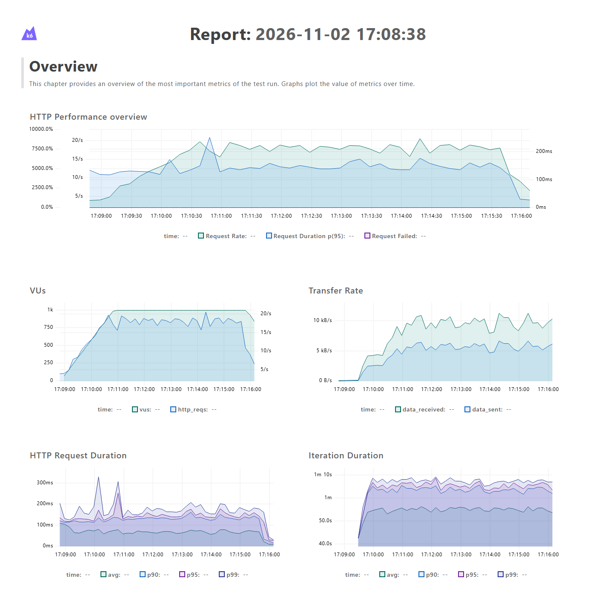
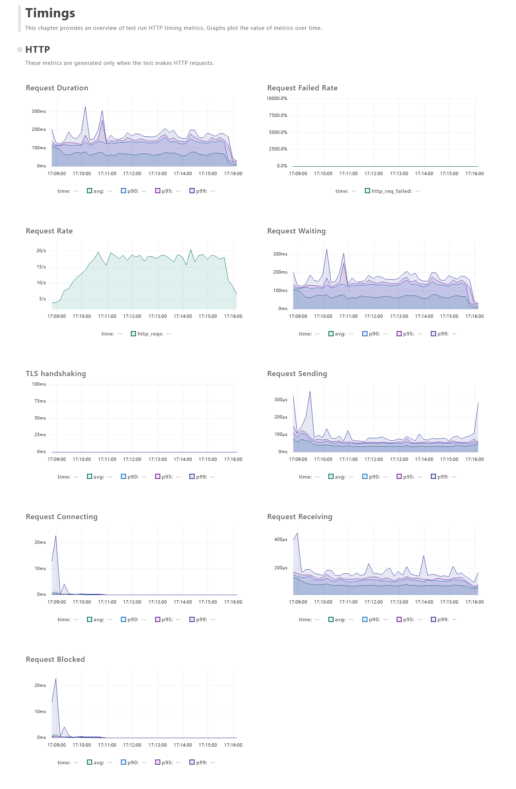
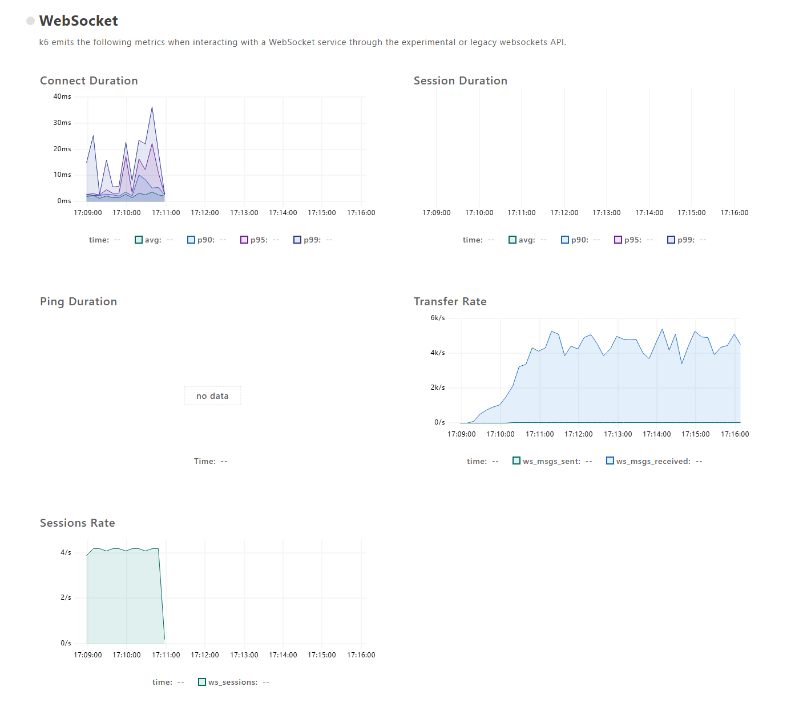
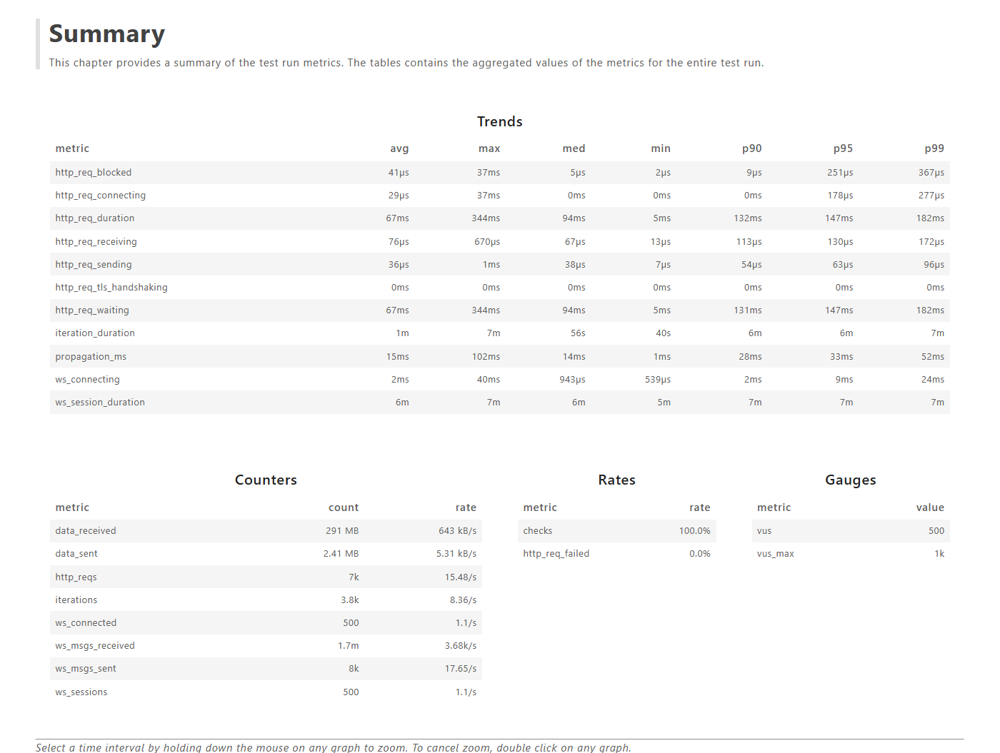
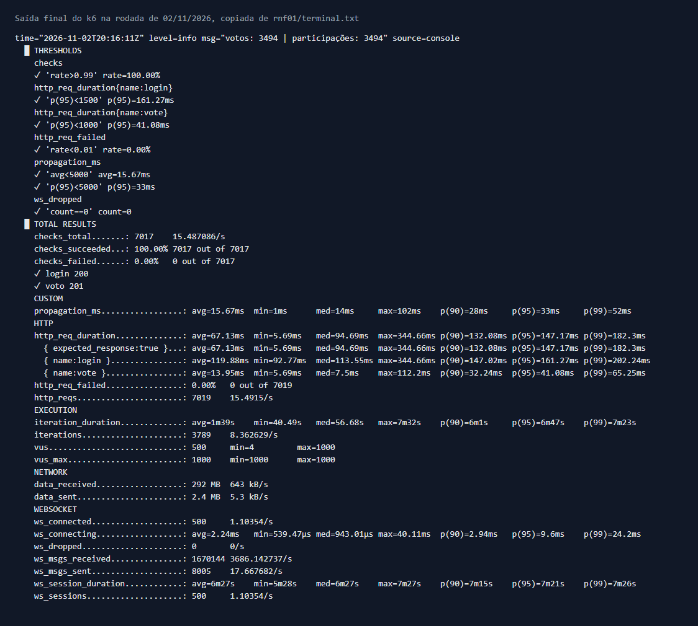
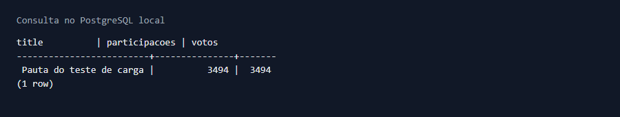
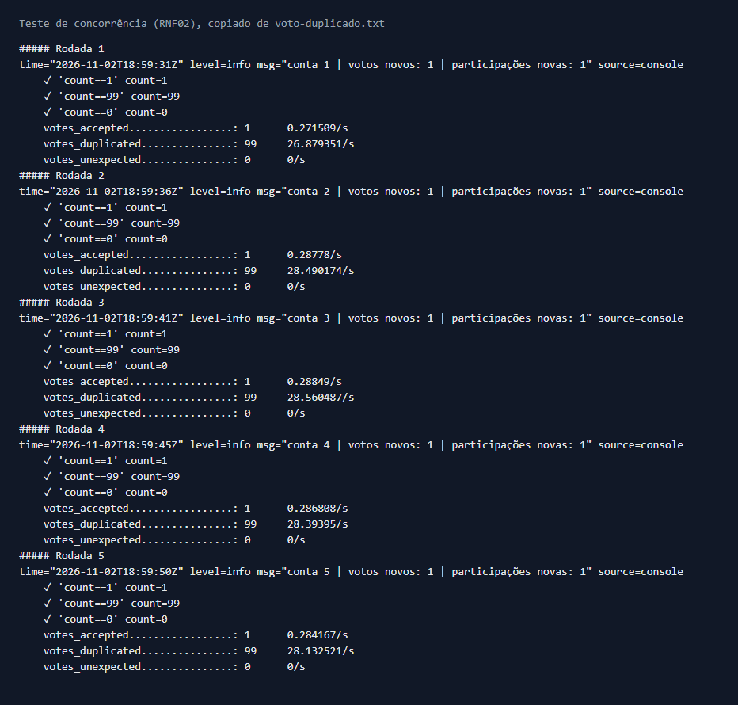
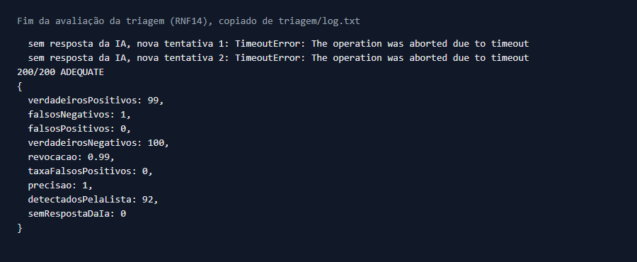

# Resultados da avaliação: RNF09, RNF01, RNF02 e RNF14

Valores medidos em 02/11/2026. Os critérios são os da Seção 3.3 da especificação. Todos os testes rodaram em **ambiente local**: nenhum foi executado na hospedagem.

## 1. Ambiente

| Item | Valor |
|---|---|
| Máquina | AMD Ryzen 7 5700X3D (8 núcleos, 16 threads), 16 GB de RAM, Windows 11 |
| Execução | Docker Desktop, com 16 núcleos e 7,7 GiB de memória disponíveis |
| Backend | Instância única, Node.js 22, `NODE_ENV=production`, Socket.io em memória |
| Banco | PostgreSQL 16, no mesmo Docker |
| Origem do k6 | k6 1.3.0 na mesma máquina, em contêiner, dividindo os recursos com o sistema |
| Hospedagem (Vercel e Render) | **Não usada nestes testes.** O sistema publicado usa Vercel para o frontend e Render Free para backend e banco |
| Versão | Commit `9077d03` mais as alterações de medição (`registeredAt` no evento e o script atualizado) |

## 2. Carga e tempo real (RNF09 e RNF01)

**Método:** 500 usuários virtuais fazem login, leem a pauta por 20 a 40 s, votam e aguardam de 20 a 30 s. Cada iteração usa uma conta diferente, sempre na mesma pauta. Em paralelo, 500 clientes conectam por WebSocket, na mesma rampa, e ficam conectados até 30 s depois do fim dos votos. Cada cliente compara o instante de recebimento de `poll-results` com o instante de registro do voto, enviado pelo backend depois da gravação no banco. O script é o [`backend/load/vote.js`](../backend/load/vote.js).

| Métrica | Critério | Valor medido | Resultado |
|---|---|---|---|
| Rampa | 2 min | 2 min | Conforme |
| Patamar | 5 min | 5 min | Conforme |
| Usuários votando no patamar | 500 | 500 | Aprovado |
| Taxa de erro HTTP | Abaixo de 1% | 0,00% (0 de 7.019) | Aprovado |
| Voto, p50 | Não definido | 7,51 ms | Informativo |
| Voto, p95 | Abaixo de 1 s | 41,09 ms | Aprovado |
| Voto, p99 | Não definido | 65,26 ms | Informativo |
| Voto, média e máximo | Não definido | 13,95 ms e 112,21 ms | Informativo |
| Conexões WebSocket mantidas | Não definido | 500, sem nenhuma queda | Informativo |
| Atraso de propagação, média | Abaixo de 5 s | 15,67 ms | Aprovado |
| Atraso de propagação, p95 | Abaixo de 5 s | 33 ms | Aprovado |
| Atraso de propagação, p99 e máximo | Não definido | 52 ms e 102 ms | Informativo |
| Votos e participações no banco | Iguais | 3.494 = 3.494 | Aprovado |

**Volume:** 7.017 logins e votos verificados, todos com sucesso, numa média de 15,5 requisições/s. Os clientes receberam 1.670.144 mensagens WebSocket. Pico do backend: 231,85% de CPU (cerca de 2,3 núcleos) e 238 MiB. Pico do PostgreSQL: 11,36% de CPU e 71,95 MiB.

Os valores da tabela vêm de `resumo.json`. O terminal corta as casas decimais, por isso mostra 41,08 ms no p95 e 65,25 ms no p99 do voto.

O relógio dos clientes e do backend é o mesmo, porque tudo rodou na mesma máquina. Isso torna o atraso comparável, mas ele não inclui rede real. A taxa média de requisições é baixa porque os usuários passam a maior parte do tempo lendo a pauta, e um pico com todos votando no mesmo segundo não foi testado.

## 3. Contas usadas no teste

As contas foram geradas pelo script [`backend/prisma/seed-load.ts`](../backend/prisma/seed-load.ts), diretamente no banco local: 4.000 cidadãos distintos, com e-mail marcado como verificado, sem CPF e com a mesma senha. O teste usou uma conta por iteração, porque cada conta só vota uma vez. O cadastro, a confirmação de e-mail e a validação de CPF não fazem parte da medição, porque o cadastro é limitado a 5 tentativas por IP em 10 minutos. Cada usuário virtual enviou um IP próprio por `X-Forwarded-For`, com `TRUST_PROXY` ativo, para que o limite de 10 logins por minuto por IP se comportasse como em usuários reais, em redes diferentes.

## 4. Concorrência do voto (RNF02)

**Método:** 100 requisições disparadas no mesmo instante pela mesma conta e sessão, na mesma pauta, em 5 rodadas com contas diferentes. O script é o [`backend/load/duplicate-vote.js`](../backend/load/duplicate-vote.js).

| Métrica por rodada | Critério | Valor medido | Resultado |
|---|---|---|---|
| Votos aceitos (201) | Exatamente 1 | 1 nas 5 rodadas | Aprovado |
| Votos recusados (409) | Os demais | 99 nas 5 rodadas | Aprovado |
| Outros erros | Nenhum | 0 nas 5 rodadas | Aprovado |
| Votos e participações novos | 1 de cada | 1 de cada nas 5 rodadas | Aprovado |

O caso de sessões ou dispositivos diferentes não foi executado.

## 5. Eficácia da triagem (RNF14)

**Método:** as 200 frases rotuladas do arquivo `backend/prisma/demo-comments.ts` (100 impróprias e 100 adequadas) passaram pela função real `screenComment`, que aplica a lista de palavras e depois o Gemini (`gemini-3.5-flash-lite`). `SUSPECT` e `INAPPROPRIATE` contam como detectados, porque o comentário não é publicado. A regra foi definida antes da execução. O script é o [`backend/scripts/evaluate-screening.ts`](../backend/scripts/evaluate-screening.ts).

| | Detectado | Não detectado |
|---|---|---|
| **Impróprio (100)** | 99 | 1 |
| **Adequado (100)** | 0 | 100 |

| Métrica | Critério | Valor medido | Resultado |
|---|---|---|---|
| Revocação | No mínimo 90% | 99% | Aprovado |
| Taxa de falsos positivos | No máximo 10% | 0% | Aprovado |
| Precisão | Reportar | 100% | Informativo |

**Detalhamento:** a lista de palavras reprovou 92 frases impróprias. Das outras 8, a IA classificou 1 como `INAPPROPRIATE`, 6 como `SUSPECT` e 1 como `ADEQUATE`. Contando só `INAPPROPRIATE`, a revocação seria de 93%. O único falso negativo foi "Essa política de aluguel social está uma porcaria."

A IA não respondeu em 7 momentos durante a avaliação, por tempo limite ou erro da API, e o script repetiu a chamada até obter resposta. Em uso real, sem repetição, esses comentários ficariam pendentes para a moderação humana. Das 200 frases, 108 passaram pela IA, com mediana de 1,37 s por frase, incluindo as repetições.

As frases têm estrutura simples. O resultado não representa comentários reais, com ironia ou gírias, e cada frase foi avaliada uma vez.

## 6. Limitações

- Os resultados não comprovam a capacidade do Render Free nem da Vercel.
- O k6 e o sistema dividiram a mesma máquina, sem latência de rede real.
- O Socket.io usa emissão em memória e vale para uma instância do backend.

## 7. Evidências

| Teste | Arquivos |
|---|---|
| RNF09 e RNF01 | [`resumo.json`](../backend/load/reports/rnf01/resumo.json), [`relatorio.html`](../backend/load/reports/rnf01/relatorio.html), [`terminal.txt`](../backend/load/reports/rnf01/terminal.txt), [`recursos.txt`](../backend/load/reports/rnf01/recursos.txt) |
| RNF02 | [`voto-duplicado.txt`](../backend/load/reports/voto-duplicado.txt) |
| RNF14 | [`resumo.json`](../backend/load/reports/triagem/resumo.json), [`resultado.json`](../backend/load/reports/triagem/resultado.json), [`log.txt`](../backend/load/reports/triagem/log.txt) |
