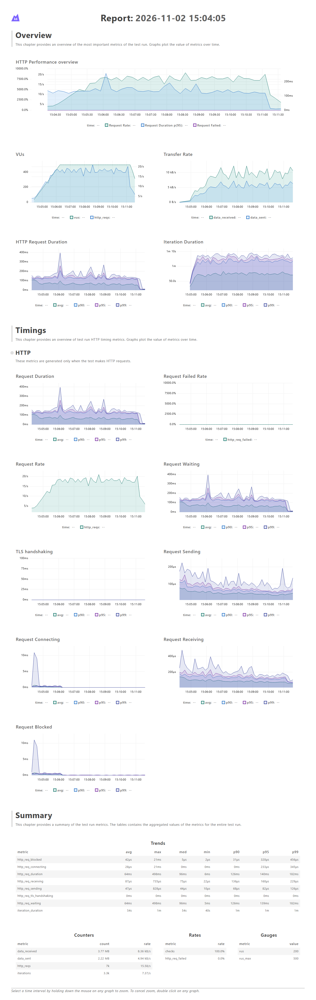

# Comprovação do teste de carga (RNF09)

**Resultado:** aprovado em ambiente local. O PautaViva sustentou 500 usuários simultâneos votando na mesma pauta por 5 minutos, com 0% de erros e nenhuma divergência entre votos e participações.

**Data:** 02/11/2026, execução encerrada às 15:11 (horário de Brasília).

## 1. Objetivo

Verificar o requisito abaixo, além da consistência dos votos sob carga (RNF02):

> **RNF09:** O sistema deve suportar, no mínimo, 500 usuários simultâneos votando em uma pauta de grande interesse, sem indisponibilidade.

## 2. Cenário

| Item | Valor |
|---|---|
| Ferramenta | k6 1.3.0 (`grafana/k6:1.3.0`) |
| Script | [`backend/load/vote.js`](../backend/load/vote.js) |
| Usuários virtuais | 500 |
| Rampa | 2 minutos, de 0 a 500 |
| Patamar | 5 minutos, com 500 |
| Fluxo | Login, leitura da pauta por 20 a 40 s, voto e espera de 20 a 30 s |
| Pauta | Uma única pauta aberta, com todos os votos nela |
| Contas | 4.000 cidadãos verificados, criados por [`backend/prisma/seed-load.ts`](../backend/prisma/seed-load.ts) |
| Regra de uso | Cada conta vota uma única vez |

## 3. Ambiente

| Item | Valor |
|---|---|
| Local | Máquina de desenvolvimento, com Docker Desktop no Windows 11 |
| Recursos do Docker | 16 núcleos e 7,7 GiB de memória, compartilhados com o k6 |
| Backend | Instância única, Node.js 22, `NODE_ENV=production`, executado com `tsx` |
| Banco | PostgreSQL 16, no mesmo Docker |
| Versão testada | Commit `b27a36e`, com os arquivos do teste ainda não commitados |

## 4. Critérios e resultados

Os critérios foram configurados no script antes da execução. A especificação (Seção 3.3) exige taxa de erros inferior a 1% e voto com p95 inferior a 1 s; o script usou 500 ms, um limite mais rigoroso. O limite de tempo do login foi definido pela equipe, porque a especificação não traz meta para ele.

| Critério | Origem | Previsto | Obtido | Resultado |
|---|---|---|---|---|
| Usuários ativos no patamar | RNF09 | 500 por 5 min | 500 (`vus_max`) | Aprovado |
| Erros HTTP | RNF09 | Abaixo de 1% | 0,00% (0 de 7.011) | Aprovado |
| Logins e votos com sucesso | RNF09 | Acima de 99% | 100% (7.009 de 7.009) | Aprovado |
| Votos iguais às participações | RNF02 | Iguais | 3.492 = 3.492 | Aprovado |
| Execução sem aborto | Validade do teste | Exit code 0 | Exit code 0 | Aprovado |
| Login, p95 | Meta da equipe | Até 1.500 ms | 156,2 ms | Aprovado |
| Voto, p95 | RNF09 | Abaixo de 1 s (script: até 500 ms) | 17,16 ms | Aprovado |

## 5. Números da execução

| Métrica | Valor |
|---|---|
| Requisições HTTP | 7.011 (média de 15,6 por segundo) |
| Logins | 3.517 |
| Votos registrados | 3.492 |
| Login | Média de 118,47 ms, p95 de 156,2 ms, máximo de 498,99 ms |
| Voto | Média de 9,83 ms, p95 de 17,16 ms, máximo de 227,05 ms |
| Iterações concluídas | 3.318 |
| Iterações interrompidas no encerramento | 199 |
| Duração total | 7m30s, sendo 7 min de carga e 30 s de encerramento |

As duas requisições além das 7.009 verificadas são a busca da pauta no início e a conferência no fim. A diferença entre logins e votos vem de 25 usuários que fizeram login e ainda estavam na espera quando o teste acabou. As iterações interrompidas são usuários encerrados pelo k6 no fim do tempo, sem nenhuma requisição com falha.

**Consumo, em amostras a cada 15 segundos:**

| Serviço | Pico de CPU | Pico de memória |
|---|---|---|
| Backend | 280,73% (cerca de 2,8 núcleos) | 232,9 MiB |
| PostgreSQL | 12,66% | 61,27 MiB |

## 6. Conferência no banco

Consulta feita após o teste, direto no PostgreSQL, sem passar pela API:

```sql
select p.title,
  (select count(*) from participations x where x."pollId" = p.id) as participacoes,
  (select count(*) from votes v where v."pollId" = p.id) as votos
from polls p where p.title = 'Pauta do teste de carga';
```

```text
          title          | participacoes | votos
-------------------------+---------------+-------
 Pauta do teste de carga |          3492 |  3492
```

O número coincide com o registrado pelo próprio teste:

```text
time="2026-11-02T18:11:35Z" level=info msg="votos: 3492 | participações: 3492" source=console
```

## 7. Histórico das execuções

| Rodada | Situação | Motivo |
|---|---|---|
| 1 | Cancelada | Interrompida para reiniciar com o painel e os relatórios ligados |
| 2 | Inválida | Sem falhas de carga, mas abortada em 6m58s porque as 3.500 contas acabaram: o dimensionamento não contou as iterações em andamento |
| 3 | **Aprovada** | Base deste documento, com 4.000 contas |

## 8. Limitações

- **Ambiente:** o resultado vale para a máquina local e não comprova a capacidade do Render Free, que tem muito menos CPU.
- **Taxa de requisições:** 500 usuários simultâneos não equivalem a 500 requisições por segundo. Os usuários passam a maior parte do tempo lendo a pauta. Um pico com todos votando no mesmo segundo não foi testado.
- **Tempo real:** o teste não abre conexões WebSocket, portanto não comprova o limite de 5 segundos do RNF01.
- **Rate limit:** o limite de login continua ativo, mas cada usuário simulado usa um IP próprio, informado com `X-Forwarded-For` e `TRUST_PROXY=true`, para se comportar como usuários reais em redes diferentes.
- **Cadastro:** as contas vêm do seed, então o cadastro e a confirmação de e-mail não fazem parte da medição.
- **Gerador de carga:** o k6 rodou na mesma máquina do sistema e dividiu os recursos com ele.

## 9. Como reproduzir

Os comandos estão na seção "Teste de carga" do [README](../README.md). O seed precisa ser executado antes de cada rodada, porque ele zera a pauta.

## 10. Conclusão

Em ambiente local, o sistema atendeu ao RNF09: sustentou 500 usuários simultâneos por 5 minutos, sem erros, com todos os votos registrados e nenhuma divergência entre votos e participações. A comprovação em produção exige repetir o teste em uma infraestrutura equivalente à final.

## 11. Anexos

Os arquivos originais estão em [`backend/load/reports/`](../backend/load/reports/). O relatório interativo do k6 é o [`relatorio.html`](../backend/load/reports/relatorio.html), e a saída completa do terminal, com o progresso de cada segundo, é o [`terminal.txt`](../backend/load/reports/terminal.txt).

### Anexo A: relatório do k6

Imagem gerada a partir do `relatorio.html`, com os horários em Brasília.



### Anexo B: saída final do terminal

```text
time="2026-11-02T18:11:35Z" level=info msg="votos: 3492 | participações: 3492" source=console

  █ THRESHOLDS

    checks
    ✓ 'rate>0.99' rate=100.00%

    http_req_duration{name:login}
    ✓ 'p(95)<1500' p(95)=156.2ms

    http_req_duration{name:vote}
    ✓ 'p(95)<500' p(95)=17.16ms

    http_req_failed
    ✓ 'rate<0.01' rate=0.00%


  █ TOTAL RESULTS

    checks_total.......: 7009    15.573775/s
    checks_succeeded...: 100.00% 7009 out of 7009
    checks_failed......: 0.00%   0 out of 7009

    ✓ login 200
    ✓ voto 201

    HTTP
    http_req_duration..............: avg=64.33ms  min=6.04ms  med=96.39ms  max=498.99ms p(90)=126.53ms p(95)=140.12ms
      { expected_response:true }...: avg=64.33ms  min=6.04ms  med=96.39ms  max=498.99ms p(90)=126.53ms p(95)=140.12ms
      { name:login }...............: avg=118.47ms min=93.55ms med=112.59ms max=498.99ms p(90)=139.95ms p(95)=156.2ms
      { name:vote }................: avg=9.83ms   min=6.04ms  med=7.91ms   max=227.05ms p(90)=13.1ms   p(95)=17.16ms
    http_req_failed................: 0.00%  0 out of 7011
    http_reqs......................: 7011   15.578219/s

    EXECUTION
    iteration_duration.............: avg=54.89s   min=40.41s  med=54.73s   max=1m9s     p(90)=1m3s     p(95)=1m5s
    iterations.....................: 3318   7.37249/s
    vus............................: 200    min=3         max=500
    vus_max........................: 500    min=500       max=500

    NETWORK
    data_received..................: 3.8 MB 8.4 kB/s
    data_sent......................: 2.2 MB 4.9 kB/s


running (7m30.1s), 000/500 VUs, 3318 complete and 199 interrupted iterations
votes ✓ [ 100% ] 198/500 VUs  7m0s
```

### Anexo C: resumo.json

Neste arquivo, `"thresholds": { "...": false }` significa que o limite **não** foi violado.

```json
{
    "root_group": {
        "name": "",
        "path": "",
        "id": "d41d8cd98f00b204e9800998ecf8427e",
        "groups": {},
        "checks": {
                "login 200": {
                    "name": "login 200",
                    "path": "::login 200",
                    "id": "48b06dc5cde7f6ebb606ad7da726a2a5",
                    "passes": 3517,
                    "fails": 0
                },
                "voto 201": {
                    "passes": 3492,
                    "fails": 0,
                    "name": "voto 201",
                    "path": "::voto 201",
                    "id": "4eee9e19c61419f2413d095588a5ee3e"
                }
            }
    },
    "metrics": {
        "http_req_duration{name:login}": {
            "avg": 118.47439739636054,
            "min": 93.55433,
            "med": 112.594049,
            "max": 498.99681,
            "p(90)": 139.958322,
            "p(95)": 156.2014208,
            "thresholds": {
                "p(95)<1500": false
            }
        },
        "http_req_waiting": {
            "med": 96.289384,
            "max": 498.841994,
            "p(90)": 126.369195,
            "p(95)": 139.9719355,
            "avg": 64.2027110738837,
            "min": 5.950451
        },
        "iteration_duration": {
            "max": 69870.010558,
            "p(90)": 63637.3466778,
            "p(95)": 65324.060809999995,
            "avg": 54895.868641758374,
            "min": 40412.467257,
            "med": 54739.728672
        },
        "http_req_sending": {
            "avg": 0.04773832377692173,
            "min": 0.01018,
            "med": 0.044435,
            "max": 0.828842,
            "p(90)": 0.068672,
            "p(95)": 0.08256250000000001
        },
        "data_received": {
            "count": 3765001,
            "rate": 8365.712498494808
        },
        "checks": {
            "passes": 7009,
            "fails": 0,
            "thresholds": {
                "rate>0.99": false
            },
            "value": 1
        },
        "http_req_duration": {
            "max": 498.99681,
            "p(90)": 126.539054,
            "p(95)": 140.125189,
            "avg": 64.33800790115518,
            "min": 6.043429,
            "med": 96.393334
        },
        "http_reqs": {
            "count": 7011,
            "rate": 15.578219056767077
        },
        "http_req_blocked": {
            "min": 0.002505,
            "med": 0.005711,
            "max": 21.899967,
            "p(90)": 0.031029,
            "p(95)": 0.320141,
            "avg": 0.042778210098417
        },
        "vus": {
            "value": 200,
            "min": 3,
            "max": 500
        },
        "iterations": {
            "rate": 7.372490490707911,
            "count": 3318
        },
        "http_req_connecting": {
            "min": 0,
            "med": 0,
            "max": 21.80729,
            "p(90)": 0,
            "p(95)": 0.23343,
            "avg": 0.028254905291684465
        },
        "http_req_tls_handshaking": {
            "max": 0,
            "p(90)": 0,
            "p(95)": 0,
            "avg": 0,
            "min": 0,
            "med": 0
        },
        "vus_max": {
            "value": 500,
            "min": 500,
            "max": 500
        },
        "http_req_failed": {
            "passes": 0,
            "fails": 7011,
            "thresholds": {
                "rate<0.01": false
            },
            "value": 0
        },
        "http_req_duration{expected_response:true}": {
            "avg": 64.33800790115518,
            "min": 6.043429,
            "med": 96.393334,
            "max": 498.99681,
            "p(90)": 126.539054,
            "p(95)": 140.125189
        },
        "http_req_receiving": {
            "p(90)": 0.136972,
            "p(95)": 0.160366,
            "avg": 0.08755850349450885,
            "min": 0.022613,
            "med": 0.075113,
            "max": 0.735319
        },
        "data_sent": {
            "count": 2223096,
            "rate": 4939.648619629534
        },
        "http_req_duration{name:vote}": {
            "min": 6.043429,
            "med": 7.91652,
            "max": 227.056786,
            "p(90)": 13.1023394,
            "p(95)": 17.168950149999983,
            "avg": 9.833802462772047,
            "thresholds": {
                "p(95)<500": false
            }
        }
    },
    "setup_data": {
        "pollId": "3043ce7e-af9d-4538-8164-c6fc2d861587"
    }
}
```

### Anexo D: consumo de CPU e memória

Amostras do `docker stats` durante a execução (`recursos.txt`), com horário, backend e PostgreSQL.

```text
15:04:05 pautaviva-backend-1 6.08% 129.6MiB / 7.717GiB | pautaviva-postgres-1 4.39% 56.33MiB / 7.717GiB
15:04:23 pautaviva-backend-1 65.55% 142.3MiB / 7.717GiB | pautaviva-postgres-1 4.78% 57.17MiB / 7.717GiB
15:04:40 pautaviva-backend-1 54.21% 154MiB / 7.717GiB | pautaviva-postgres-1 1.20% 57.83MiB / 7.717GiB
15:04:56 pautaviva-backend-1 43.38% 164.1MiB / 7.717GiB | pautaviva-postgres-1 1.21% 57.47MiB / 7.717GiB
15:05:14 pautaviva-backend-1 124.43% 165.2MiB / 7.717GiB | pautaviva-postgres-1 5.86% 57.72MiB / 7.717GiB
15:05:30 pautaviva-backend-1 107.83% 165.9MiB / 7.717GiB | pautaviva-postgres-1 2.61% 57.85MiB / 7.717GiB
15:05:46 pautaviva-backend-1 101.56% 165.8MiB / 7.717GiB | pautaviva-postgres-1 2.28% 57.65MiB / 7.717GiB
15:06:04 pautaviva-backend-1 280.73% 232.9MiB / 7.717GiB | pautaviva-postgres-1 12.66% 58.12MiB / 7.717GiB
15:06:21 pautaviva-backend-1 140.75% 199.2MiB / 7.717GiB | pautaviva-postgres-1 3.44% 60.71MiB / 7.717GiB
15:06:38 pautaviva-backend-1 100.69% 167.3MiB / 7.717GiB | pautaviva-postgres-1 11.10% 60.94MiB / 7.717GiB
15:06:55 pautaviva-backend-1 170.61% 232.1MiB / 7.717GiB | pautaviva-postgres-1 3.06% 60.85MiB / 7.717GiB
15:07:12 pautaviva-backend-1 76.44% 168MiB / 7.717GiB | pautaviva-postgres-1 3.71% 60.77MiB / 7.717GiB
15:07:29 pautaviva-backend-1 115.44% 168.5MiB / 7.717GiB | pautaviva-postgres-1 3.59% 60.97MiB / 7.717GiB
15:07:45 pautaviva-backend-1 171.09% 210MiB / 7.717GiB | pautaviva-postgres-1 4.84% 61.27MiB / 7.717GiB
15:08:03 pautaviva-backend-1 181.85% 167.7MiB / 7.717GiB | pautaviva-postgres-1 3.46% 60.6MiB / 7.717GiB
15:08:19 pautaviva-backend-1 82.39% 177.2MiB / 7.717GiB | pautaviva-postgres-1 7.03% 60.57MiB / 7.717GiB
15:08:36 pautaviva-backend-1 154.33% 168.1MiB / 7.717GiB | pautaviva-postgres-1 4.07% 60.78MiB / 7.717GiB
15:08:53 pautaviva-backend-1 202.19% 168.2MiB / 7.717GiB | pautaviva-postgres-1 4.37% 60.71MiB / 7.717GiB
15:09:10 pautaviva-backend-1 35.29% 200.2MiB / 7.717GiB | pautaviva-postgres-1 3.44% 60.55MiB / 7.717GiB
15:09:27 pautaviva-backend-1 88.22% 200.4MiB / 7.717GiB | pautaviva-postgres-1 3.50% 60.84MiB / 7.717GiB
15:09:44 pautaviva-backend-1 77.50% 175.4MiB / 7.717GiB | pautaviva-postgres-1 4.17% 60.73MiB / 7.717GiB
15:10:01 pautaviva-backend-1 60.77% 201.1MiB / 7.717GiB | pautaviva-postgres-1 8.64% 60.88MiB / 7.717GiB
15:10:18 pautaviva-backend-1 61.85% 192.6MiB / 7.717GiB | pautaviva-postgres-1 2.64% 60.62MiB / 7.717GiB
15:10:35 pautaviva-backend-1 103.81% 167.6MiB / 7.717GiB | pautaviva-postgres-1 3.66% 60.66MiB / 7.717GiB
15:10:52 pautaviva-backend-1 140.43% 167.9MiB / 7.717GiB | pautaviva-postgres-1 2.55% 60.75MiB / 7.717GiB
15:11:09 pautaviva-backend-1 5.42% 167.9MiB / 7.717GiB | pautaviva-postgres-1 2.35% 60.96MiB / 7.717GiB
15:11:26 pautaviva-backend-1 28.26% 167.7MiB / 7.717GiB | pautaviva-postgres-1 6.97% 60.63MiB / 7.717GiB
15:11:43 pautaviva-backend-1 0.17% 167.6MiB / 7.717GiB | pautaviva-postgres-1 0.01% 60.53MiB / 7.717GiB
15:12:00 pautaviva-backend-1 0.62% 167.9MiB / 7.717GiB | pautaviva-postgres-1 0.10% 60.47MiB / 7.717GiB
15:12:17 pautaviva-backend-1 0.42% 167.6MiB / 7.717GiB | pautaviva-postgres-1 4.56% 60.54MiB / 7.717GiB
```
